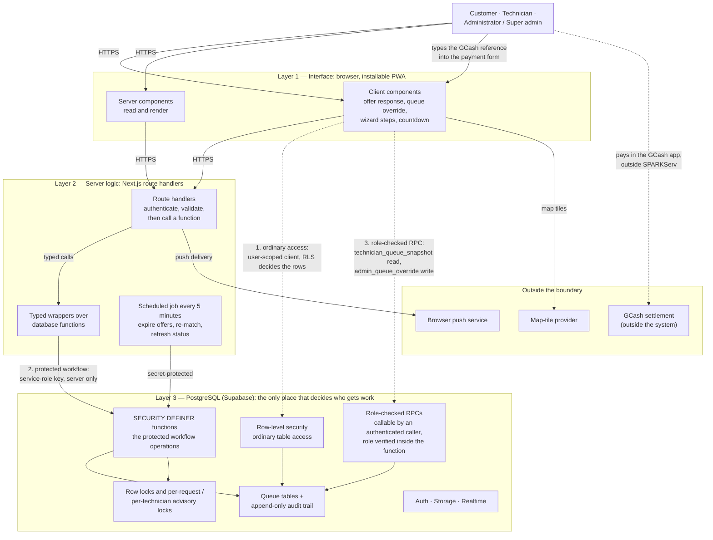
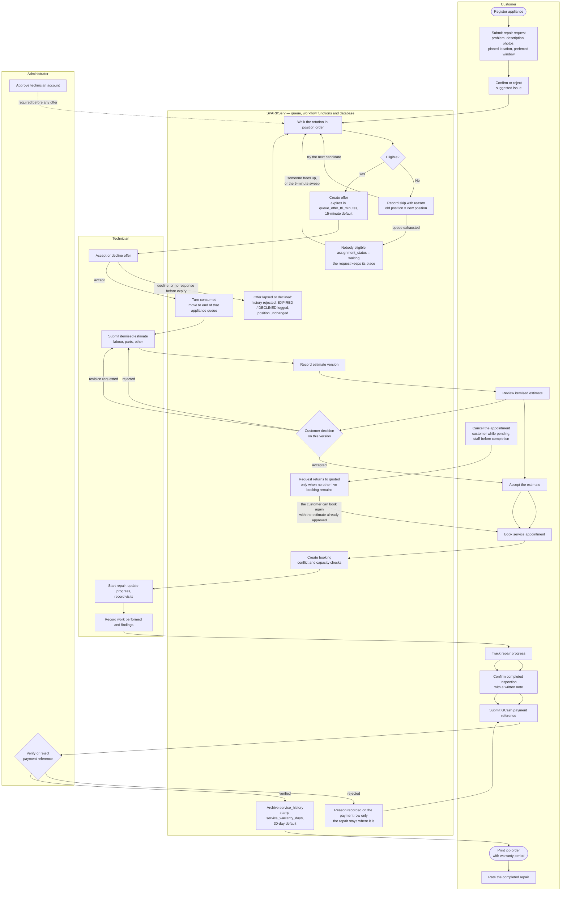
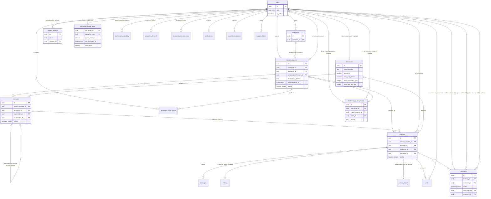
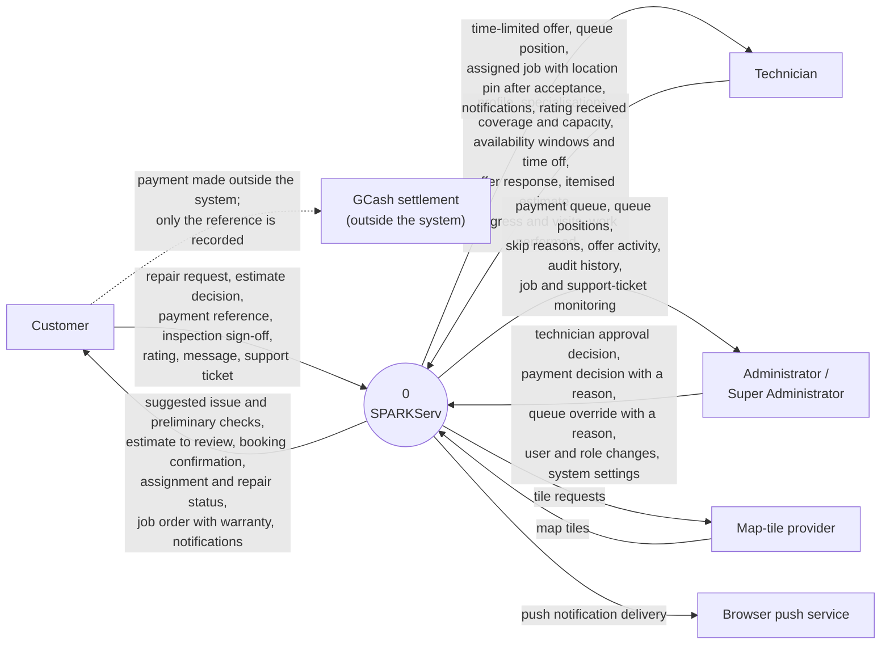
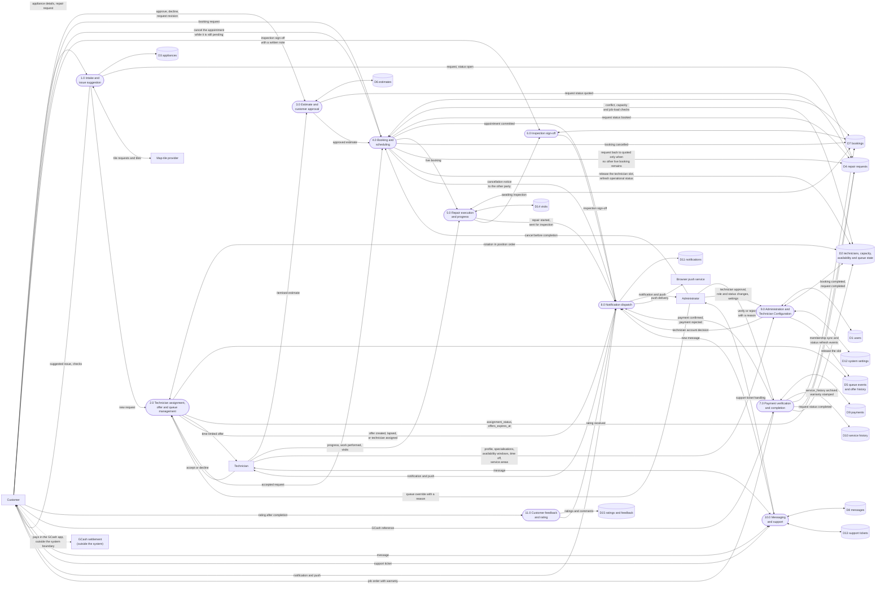

# SPARKServ — Chapter III Figures

Verified diagram sources for the BSIT capstone manuscript. Every label here was checked
against `supabase/schema.sql`, `supabase/migration_*.sql` and `src/`, not against the
earlier draft. Corrections found during verification are listed in §0.

**How to render.** Paste each block into <https://mermaid.live> → *Actions → Download
PNG/SVG*, white background, PNG scale 3×. Mermaid cannot draw stick figures or true UML
ellipses; for Figure 3.1 a PlantUML alternative is noted beneath it.

**Figure numbering.** 3.1–3.7 as below; prototype screenshots become **3.8 onward** (the
manuscript currently numbers them 3.7–3.27 and its text promises "from Figure 3.6", which
is unassigned).

| Figure | Content | Source of truth |
| --- | --- | --- |
| 3.1 | Use-case functions by actor | `src/middleware.ts`, `ROLES-AND-PERMISSIONS.md` |
| 3.2 | System architecture (three layers) | `src/lib/supabase/*`, RPC access table in `QUEUE-SYSTEM.md` |
| 3.3 | Repair request workflow | transition matrices in `schema.sql` + `migration_estimate_workflow.sql` |
| 3.4 | Queue offer sequence | `migration_queue_redesign.sql`, `migration_offer_lifecycle.sql` |
| 3.5 | Entity-relationship diagram | `schema.sql`, `migration_queue_redesign.sql` |
| 3.6 | Context diagram (Level 0 DFD) | `src/app/api/**`, `.env.example` |
| 3.7 | Level 1 DFD | route handlers, RPCs, triggers |

---

## 0. Verification results

| # | Check | Verdict | Evidence |
| --- | --- | --- | --- |
| 1 | Table names, FKs, uniques, cardinality | **Verified, with 7 corrections** | `schema.sql`; see §0.1 |
| 2 | Queue event names | **Verified — 18 actions, exact** | `migration_queue_redesign.sql:354-360` |
| 3 | Browser countdowns do not control expiry | **Verified** | see §0.3 |
| 4 | GCash is external, no API integration | **Verified** | see §0.4 |
| 5 | RLS access vs server-side function calls | **Verified, distinguished** | `QUEUE-SYSTEM.md:201-216`; `DATABASE.md:746-790` |
| 6 | Figure 3.7 flows | **Five corrections applied** | see §0.6 |
| 7 | Override routing and audit writers | **Verified** | `migration_queue_redesign.sql:1656-1757`; §0.7 |
| 8 | Status transitions | **Verified, exact** | see §0.8 |

### 0.1 Corrections to the earlier ERD draft

1. **`visits.technician_id` references `users(id)`, not `technicians(id)`** — so the visits
   edge leaves `users` (`schema.sql:707`).
2. **There are two different technician foreign keys**, and the ERD must not merge them:
   `estimates`, `bookings`, `ratings` and `service_history` reference **`technicians(id)`**;
   `visits`, `technician_queue_state`, `technician_offer_history` and
   `technician_queue_events` reference **`users(id)`**.
3. **`payments.customer_id` references `users(id)`** (`schema.sql:742`), and
   `system_settings.updated_by` references `users(id)` (`schema.sql:869`) — the earlier
   draft drew no edge for either.
4. **Three configuration tables were missing** from the earlier draft and from the
   manuscript's §3.4 table: `technician_availability`, `technician_time_off`,
   `technician_service_areas` (`migration_queue_redesign.sql:396-453`).
5. **`technician_queue_events` carries two different users**, and the earlier draft drew
   only one: `technician_id` (the subject, nullable) and `actor_id` (who caused it,
   nullable — a user id only for an administrative override). Both are separate edges.
6. **`service_requests.assigned_technician_id` was re-checked and does reference
   `users(id)`** (`schema.sql:131`), not `technicians(id)` — the figure is correct on that
   point, and the column is nullable while a request is `matching` or `waiting`.
7. **The earlier note claiming `system_settings` has no relationships was wrong** and has
   been removed: `updated_by → users(id)` (`schema.sql:869`).

Rule-bearing unique constraints to list in the figure legend:
`uniq_active_booking_per_request` (`status <> 'cancelled'`),
`uniq_live_estimate_per_request` (`status in ('draft','pending','revision_requested')`),
`uniq_approved_estimate_per_request` (`status = 'accepted'`),
`uniq_active_offer_per_technician` (`assignment_status = 'offered'`),
`ratings.booking_id` unique, `service_history.booking_id` unique,
`technician_queue_state` PK `(technician_id, appliance_type)`,
`visits` unique `(booking_id, visit_number)`, `push_subscriptions.endpoint` unique.

### 0.2 Queue event names — verified, 18 actions

`JOINED_QUEUE`, `TURN_CONSUMED`, `MOVED_TO_END`, `POSITION_CHANGED`,
`SKIPPED_DUE_TO_SCHEDULE`, `SKIPPED_DUE_TO_CAPACITY`, `SKIPPED_DUE_TO_UNAVAILABLE`,
`SKIPPED_DUE_TO_SERVICE_AREA`, `SKIPPED_DUE_TO_ACTIVE_OFFER`, `OFFERED`, `ACCEPTED`,
`DECLINED`, `EXPIRED`, `REMOVED`, `REACTIVATED`, `STATUS_CHANGED`,
`WAITING_FOR_TECHNICIAN`, `ADMIN_OVERRIDE`.

Every skip records `old_position = new_position`, which is how the audit trail proves a
skip is not a demotion. `technician_offer_history.status` uses a **different, smaller**
vocabulary: `offered`, `accepted`, `rejected`.

### 0.3 Countdowns are display-only — verified

* `src/components/AssignmentStatusCard.tsx:104-115` — `OfferCountdown` recomputes
  `remainingMs` from its `expiresAt` prop on a 1-second `setInterval`. It calls nothing.
* `src/app/technician/estimate-requests/page.tsx:147` — the technician screen computes
  `offerExpired` client-side only to disable the button; a hint, not the control.
* The control is in the database: `respond_to_offer()` refuses a response whose
  `offers_expires_at <= now()`, marks the history row `rejected` with reason
  `'Offer expired'`, logs `EXPIRED` and clears the assignment
  (`migration_offer_lifecycle.sql:415-436`).
* Expiry is driven by two different functions, and the earlier draft conflated them:
  **`expire_stale_offers()`** (the scheduled sweep) releases inline and then re-walks via
  `assign_technician_to_request()`, while **`assign_technician_to_request()`** releases
  *other* requests' lapsed offers through `lapse_offer(..., 'waiting')`
  (`migration_offer_lifecycle.sql:197-207`). `lapse_offer()` is the release primitive for
  the pre-walk path, the `lapse_offer_on_cancel` trigger and the "request was already
  cancelled" case — but not for the sweep.
* **A legacy helper to keep out of the figures:** `expire_offer(request_id)`
  (`schema.sql:1105`) still exists and `npm run db:check` still tracks it as an object of
  step 2, but **no function and no route calls it** — `expire_stale_offers()`,
  `lapse_offer()` and `respond_to_offer()` superseded it. It appears in no diagram.

### 0.4 GCash is external — verified

`payments.gcash_reference` is **free text** typed by the customer (`schema.sql:744`;
`src/components/PaymentForm.tsx:44`). There is no GCash endpoint, credential or SDK
anywhere in `src/`. The decision is manual and administrator-only: `confirm_payment()` /
`reject_payment()`. Table privileges are narrowed so `authenticated` holds
`SELECT, INSERT`, `service_role` holds `SELECT` only, and `anon` holds none
(`DATABASE.md:752-757`).

### 0.5 Two kinds of database access — verified

| Kind | How it works | Examples |
| --- | --- | --- |
| **Ordinary RLS-protected access** | The user-scoped client talks to the table directly; RLS policies decide rows | appliances CRUD; `service_requests` insert + limited update; `messages`; `ratings` insert; `payments` insert/select; `support_tickets`; `notifications` read/mark-read; `push_subscriptions`; `visits`; technician profile and availability |
| **Protected workflow operations** | A `SECURITY DEFINER` function, called server-side with the service-role client; `REVOKE`d from `anon`/`authenticated` | `assign_technician_to_request`, `respond_to_offer`, `expire_stale_offers`, `consume_queue_turn`, `lapse_offer`, `log_queue_event`, `refresh_technician_operational_status`, `create_booking_atomic`, `confirm_payment`, `reject_payment`, `submit_estimate`, `decide_estimate` |

Two functions are deliberately callable by a signed-in caller because they check the role
**inside**: `technician_queue_snapshot(text)` (read) and
`admin_queue_override(text, uuid, text, text)` (reason-required write).

### 0.6 Figure 3.7 corrections applied

| Was | Now |
| --- | --- |
| D5 written only by process 2.0 | D5 is written by **2.0** (OFFERED, SKIPPED_*, ACCEPTED, DECLINED, EXPIRED, WAITING_FOR_TECHNICIAN, TURN_CONSUMED, MOVED_TO_END, ADMIN_OVERRIDE) **and by 9.0 / profile changes** through `sync_queue_membership` (JOINED_QUEUE, REMOVED, REACTIVATED) and `refresh_technician_operational_status` (STATUS_CHANGED) |
| D10 written only by 7.0 | **D10 = `service_history`, written only by 7.0.** `ratings` moved out to **D15**, written only by the new **11.0** |
| 8.0 fed only by 2.0 | 8.0 is fed by **2.0, 4.0, 5.0, 6.0, 11.0, 7.0, 9.0 and 10.0** (eight inputs) |
| Visits folded into bookings | `visits` is its own store, **D14**, written by **5.0**, unique per `(booking_id, visit_number)` |
| GCash drawn as feeding the system | The payment arrow runs **Customer → GCash**, outward, and stops there; the reference enters separately through 7.0 |

### 0.7 Override routing and audit attribution — verified

`admin_queue_override(p_appliance_type, p_technician_id, p_action, p_reason)` re-checks
`is_admin()`, refuses an empty reason, and writes an `ADMIN_OVERRIDE` event naming
`actor_id` (`migration_queue_redesign.sql:1656-1757`). Its actions are `move_to_end`,
`remove` and `reactivate`. It is granted to `authenticated` (admin-checked inside) and
`service_role`, and reached through `POST /api/admin/queue-override`. Every one of the 18
audit actions has an identified writer — see Appendix A.

### 0.8 Status transitions — verified

| Object | Transitions | Enforced by |
| --- | --- | --- |
| `estimates.status` | `draft → pending` on submit (a draft is edited in place); `pending → accepted` / `rejected` / `revision_requested` on the customer's decision; any live version (`draft`, `pending`, `revision_requested`, `accepted`) → `superseded` when a new version is submitted | `submit_estimate()`, `decide_estimate()` (`migration_estimate_workflow.sql:205-293`, `330-382`) |
| `bookings.status` | `pending → in_progress → awaiting_inspection → awaiting_payment → completed`; `cancelled` from `pending` (customer) or from any non-completed state (staff). `completed` is **final**. Customer, request, technician, estimate, `scheduled_at` and `duration_minutes` are immutable | `enforce_booking_update_rules()` (`schema.sql:1134-1252`) |
| inspection sign-off | `awaiting_inspection → awaiting_payment` **only by the customer**, **only with a non-blank `inspection_note`**; `inspection_confirmed_at` is set by the database (`coalesce(old, now())`), never by the caller | same trigger, lines 1222-1244 |
| `payments.status` | `pending_verification → confirmed` (verify) or `→ rejected` (refuse, reason 1–500 non-whitespace characters); the row is then frozen | `confirm_payment()`, `reject_payment()`, `enforce_payment_decision_rules()` |
| repair completion | **only** `confirm_payment()`, in one transaction: payment `confirmed`, booking `completed`, `service_history` archived (warranty stamped), request `completed`, technician slot released | `DATABASE.md:448`; `migration_rls_workflow_enforcement.sql:548-619` |
| payment rejection | writes one row and **nothing else** — booking, request, `active_job_load` and `service_history` untouched | `DATABASE.md:705-712` |
| `service_requests.status` | `open → quoted` (estimate submitted) `→ booked` (booking created) `→ completed` (payment verified); `booked → quoted` when the last live booking is cancelled; `→ cancelled` by customer or staff | `migration_estimate_workflow.sql:223-225`; `migration_atomic_booking.sql:443`; `schema.sql:1259+`; `migration_rls_workflow_enforcement.sql:619` |
| `service_requests.assignment_status` | `matching → offered → accepted`; `→ waiting` when nobody is eligible; a lapsed offer returns the request to `matching` / `waiting`. Pinned to the engine — a customer update touching it is refused | `schema.sql:132-133`, `1292-1316` |

> **One observation worth knowing before a panel finds it:** `request_status` declares
> `in_progress` (`schema.sql:11`), but **no function or trigger ever writes it** — every
> `in_progress` in the schema belongs to `booking_status`, `visit_status` or
> `ticket_status`. Repair progress is tracked on the **booking**, not the request, so the
> figures below show no request-level `in_progress` state.

---

## Figure 3.1 — Use-case functions by actor

```mermaid
flowchart LR
    C["Customer"]
    T["Technician"]
    A["Administrator"]
    S["Super Administrator"]

    subgraph SYS["SPARKServ — system boundary"]
        direction LR
        subgraph GC[" "]
            direction TB
            c1(["Register and manage appliances"])
            c2(["Submit a repair request"])
            c3(["Confirm or reject a suggested issue"])
            c4(["Read preliminary troubleshooting checks"])
            c5(["Accept or decline an estimate"])
            c6(["Book a service appointment"])
            c7(["Track repair progress"])
            c8(["Message the assigned technician"])
            c9(["Confirm the completed inspection"])
            c10(["Submit a GCash payment reference"])
            c11(["Print the job order"])
            c12(["Rate the completed repair"])
            c13(["Open a support ticket"])
        end
        subgraph GT[" "]
            direction TB
            t1(["Maintain profile, specialisations,<br/>service area and capacity"])
            t2(["View queue position per appliance"])
            t3(["Accept or decline a time-limited offer"])
            t4(["Submit a versioned itemised estimate"])
            t5(["Update repair progress"])
            t6(["Record work performed and findings"])
            t7(["Message the customer"])
        end
        subgraph GA[" "]
            direction TB
            a1(["Approve or refuse a technician account"])
            a2(["Verify or reject a payment reference"])
            a3(["Monitor the queue, skip reasons<br/>and offer activity"])
            a4(["Override a queue position"])
            a5(["Monitor jobs and support tickets"])
            a6(["Manage users and system settings"])
        end
        subgraph GS[" "]
            direction TB
            s1(["Manage administrator accounts"])
            s2(["View system activity"])
            s3(["Manage settings"])
        end
    end

    C --- c1 & c2 & c3 & c4 & c5 & c6 & c7 & c8 & c9 & c10 & c11 & c12 & c13
    T --- t1 & t2 & t3 & t4 & t5 & t6 & t7
    A --- a1 & a2 & a3 & a4 & a5 & a6
    S --- s1 & s2 & s3
```



**Caption:** `Figure 3.1. Use-case functions of SPARKServ by actor`

Notes to keep the figure honest:

* Arrows mean **"may invoke"**, not sequence. The chronology is Figure 3.3.
* `a4 Override a queue position` must carry the qualifier **"written reason required;
  audited"** in the figure legend — the function refuses an empty reason
  (`migration_queue_redesign.sql:1675-1677`).
* The customer has **no** use case for choosing or switching a technician, and none for
  route navigation. Do not add them.
* **PlantUML alternative** for true UML ellipses and stick figures:
  `@startuml` / `left to right direction` / `:Customer: --> (Submit a repair request)` /
  `@enduml`.

---

## Figure 3.2 — System architecture

The one thing this figure must show that the earlier draft blurred: **two different ways
data reaches the database**, only one of which is a decision.



**Caption:** `Figure 3.2. System architecture of SPARKServ`

Notes:

* **Three database paths, and they must stay distinct:**
  1. **ordinary access** — the user-scoped client reads or writes a table and RLS decides
     the rows;
  2. **protected workflow operation** — a route handler calls a `SECURITY DEFINER` function
     with the service-role key; the function is revoked from `anon` and `authenticated`;
  3. **role-checked RPC** — callable by an authenticated caller, but the function verifies
     the role inside. Only two functions are in this group:
     `technician_queue_snapshot(text)` (read: a technician sees the queues they belong to, an
     administrator sees all) and `admin_queue_override(text, uuid, text, text)`
     (write: refuses a non-administrator and an empty reason).
* Example labels for path 2 if you want them in the legend:
  `assign_technician_to_request`, `respond_to_offer`, `expire_stale_offers`,
  `create_booking_atomic`, `confirm_payment`, `reject_payment`.
* **The payment path is a customer action, not an integration.** The customer pays in the
  GCash app and then **types the reference into the form**, which travels through path 1
  (an `INSERT` into `payments` pinned to `pending_verification`). Draw the GCash box with a
  dashed edge to the *customer* only. **No arrow may run from GCash into SPARKServ** — there
  is no endpoint, credential or webhook, and the administrator's decision
  (`confirm_payment` / `reject_payment`) is a separate step through path 2.
* Do not draw a Google Maps box, a payment-gateway box, an AI/language-model box, or a
  ranking/scoring box. None exists in the repository.

---

## Figure 3.3 — Repair request workflow



**Caption:** `Figure 3.3. SPARKServ repair request workflow`

Status annotations to place on the figure (this is what makes it verifiable):

| Step | Object and value |
| --- | --- |
| Request submitted | `service_requests.status = open`, `assignment_status = matching` |
| Offer created | `assignment_status = offered`, `offers_expires_at = now() + queue_offer_ttl_minutes` (**15-minute default**, `migration_offer_lifecycle.sql:219`) |
| Queue exhausted | `assignment_status = waiting` — the request keeps its place and is re-walked when someone frees up or the 5-minute sweep runs |
| Accepted | `assignment_status = accepted` |
| Lapsed / declined | request returns to `matching` / `waiting`; **position unchanged** |
| Estimate submitted | `estimates.status = draft → pending`; `service_requests.status = open → quoted` |
| Decision: accepted | `estimates.status = accepted`; the request proceeds to booking |
| Decision: rejected | `estimates.status = rejected`; the request stays `quoted`, and the technician may submit a **new version** |
| Decision: revision requested | `estimates.status = revision_requested`; the technician submits a new version |
| New version submitted | every live version (`draft`, `pending`, `revision_requested`, `accepted`) → `superseded` |
| Booking created | `bookings.status = pending`; `service_requests.status = quoted → booked` |
| Repair started | `bookings.status = pending → in_progress` |
| Sent for inspection | `bookings.status = in_progress → awaiting_inspection` |
| Inspection signed off | `awaiting_inspection → awaiting_payment` (**customer only, written note required**) |
| Reference submitted | `payments.status = pending_verification` |
| Reference refused | `pending_verification → rejected`; **the repair does not move** |
| Reference verified | `pending_verification → confirmed`; booking `awaiting_payment → completed`; `service_history` archived with `warranty_days = service_warranty_days` (**30-day default**, `schema.sql:889`) and `warranty_until` computed in the service timezone; request → `completed`; technician slot released |
| Appointment cancelled | `bookings.status = cancelled`; **no queue turn is re-spent**; the request returns to `quoted` **only when no other live booking remains for it** (`schema.sql:1259+`) |

Four loops must be visible, and every one of them must carry its "no change" or "return"
annotation: the **skip loop**, the **queue-exhausted loop** (via `waiting`), the
**decline/lapse loop**, and the **rejection loop**. The estimate decision is the branch that
must not be collapsed into a single "customer approves" arrow.

Add this note under the figure so the countdown cannot be misread:

> The 15-minute figure is the configured offer lifetime. The countdown shown in the
> interface is display only; the database refuses a response after `offers_expires_at`
> and the scheduled sweep lapses the offer.

---

## Figure 3.4 — Queue offer sequence

```mermaid
sequenceDiagram
    autonumber
    actor C as Customer
    participant W as Repair request form
    participant API as POST /api/service-requests
    participant F as assign_technician_to_request
    participant R as respond_to_offer
    participant Q as consume_queue_turn
    participant DB as PostgreSQL
    participant T1 as Technician #1, position 1
    participant T2 as Technician #2, position 2
    participant CRON as Scheduled sweep, every 5 minutes

    C->>W: appliance, problem, description, photos, location, window
    W->>API: submit repair request
    API->>DB: insert request, status open, assignment_status matching
    API->>F: assign technician, service-role only
    Note over F,DB: one transaction
    F->>DB: lock the request row and take a per-request advisory lock
    F->>DB: never offer a cancelled or completed request, outcome unchanged
    F->>DB: release OTHER requests' already-lapsed offers through lapse_offer
    F->>DB: read this appliance's rotation in queue_position order
    F->>DB: Technician #1 fails a capacity check
    F->>DB: log SKIPPED_DUE_TO_CAPACITY, old position = new position
    F->>DB: claim the request for Technician #2
    Note over DB: assignment_status = offered,<br/>offers_expires_at = now + queue_offer_ttl_minutes,<br/>15-minute default
    DB-->>F: claim accepted, or unique violation when #2 already holds a live offer
    F->>DB: insert technician_offer_history, status offered
    F->>DB: log OFFERED with the expiry time
    F->>DB: refresh_technician_operational_status
    F-->>API: outcome offered
    API->>T2: notify, in-app and browser push

    alt accepted before expiry
        T2->>API: accept
        API->>R: respond to offer, service-role only
        R->>DB: lock the request row, confirm it is still offered to this technician
        R->>DB: assignment_status = accepted, offers_expires_at cleared
        R->>DB: technician_offer_history status accepted
        R->>Q: consume_queue_turn, this technician and this appliance
        Q->>DB: position moves to the end of the rotation, turn_count plus one
        Q->>DB: log TURN_CONSUMED then MOVED_TO_END
        R->>DB: log ACCEPTED with the new position
        R-->>API: outcome accepted
        API->>C: notify that a technician accepted
    else declined
        T2-->>API: decline with a reason
        API->>R: respond to offer
        R->>DB: technician_offer_history rejected, log DECLINED
        Note over R,DB: queue_decline_consumes_turn defaults to false, so no turn<br/>is consumed; when it is true, R calls consume_queue_turn
        R->>DB: assignment_status = matching, offers_expires_at cleared
        R->>F: assign_technician_to_request, the request is re-walked
    else no response before expiry
        CRON->>DB: expire_stale_offers, scheduled every 5 minutes
        DB->>DB: history rejected, log EXPIRED, assignment cleared to matching
        DB->>F: assign_technician_to_request for each lapsed request
        Note over DB: position unchanged
    else acceptance arrives after expiry
        T2-->>API: accept, too late
        API->>R: respond to offer
        R->>DB: history rejected, log EXPIRED, assignment cleared
        R->>F: assign_technician_to_request, the request is re-walked
        R-->>API: outcome expired, the offer was not accepted
    end

    Note over F,DB: if no candidate was eligible,<br/>assignment_status = waiting, not matching
```

**Caption:** `Figure 3.4. Queue offer sequence for an incoming repair request`

Facts the figure must make visible, each verified against the call graph:

* **The four outcomes are one `alt` block, not a happy path with exceptions.** Acceptance,
  decline, scheduled expiry and late acceptance are **mutually exclusive branches of the
  same decision**, so the response sits inside the `alt` and nothing after the offer is drawn
  as a straight line — nothing after the offer is guaranteed.
* **Three separate functions, three separate lifelines.** `assign_technician_to_request()`
  creates the offer; `respond_to_offer()` processes the technician's answer;
  `consume_queue_turn()` is what actually moves the position. Collapsing them into one box
  hides the fact that the response is never handled by the assign function.
* **The call direction is `respond_to_offer → assign_technician_to_request`**, not the
  reverse. On **decline** (`migration_offer_lifecycle.sql:497-504`) and on a
  **response that arrives after expiry** (`...:426-433`) the response function clears the
  assignment and re-enters the walk itself.
* **`consume_queue_turn()` is called from three places**, and the figure should show the
  first two: on **acceptance** (`...:457`), on **decline only when
  `queue_decline_consumes_turn` is true** (default `false`, `...:490-494`), and from
  `admin_queue_override('move_to_end')` (`migration_queue_redesign.sql:1682`).
* **Expiry has two real paths, and they use different functions:**
  * the **scheduled sweep** — `expire_stale_offers()` (`migration_queue_redesign.sql:1602-1651`)
    does the release *inline* (history rejected, `EXPIRED` logged, assignment back to
    `matching`) and then calls `assign_technician_to_request()` per lapsed request. It does
    **not** call `lapse_offer()`;
  * the **next assignment walk** — `assign_technician_to_request()` releases *other*
    requests' lapsed offers through `lapse_offer(..., 'waiting')`
    (`migration_offer_lifecycle.sql:197-207`), deliberately without re-offering, so the walk
    cannot recurse into itself.
  `lapse_offer()` is therefore the single release primitive for the pre-walk path, the
  cancellation trigger, and the "request was cancelled before a response" case — but not
  for the sweep.
* **The offer is claimed by a conditional update, not by application logic** —
  `assignment_status in ('matching','waiting')` is the condition, and the partial unique
  index `uniq_active_offer_per_technician` turns a double offer into a unique violation the
  walk skips past (`migration_offer_lifecycle.sql:264-287`).
* **`technician_offer_history` doubles as the "already offered this request to this
  technician" guard**, so a re-walk can never re-offer to the same person
  (`DATABASE.md:244-249`).
* **A skip is recorded with `old_position = new_position`** — that equality is the proof
  that a skip is not a demotion (`migration_offer_lifecycle.sql:247-252`).
* **Nobody eligible means `waiting`, never `matching`** (`...:321-330`).
* **The TTL is `queue_offer_ttl_minutes`, default 15** (`...:219`), so label it
  "15-minute default (configurable)", not a fixed 15 minutes.
* **The countdown is not in this diagram on purpose.** The refusal lives in
  `respond_to_offer()`; the interface only displays `offers_expires_at`.

---

## Figure 3.5 — Entity-relationship diagram



**Caption:** `Figure 3.5. Entity-relationship diagram of SPARKServ (key fields shown)`

Notes:

* **Figure type:** a **relationship-focused ERD showing *selected* PK/FK fields, not all
  database columns.** The blocks carry identity and relationship keys only — no timestamps,
  no money columns, no status metadata beyond the status itself. Full column detail is in
  `DATABASE.md`. State this in the figure legend so the omission reads as deliberate.
* **Optional cardinalities mark nullable foreign keys.** The `|o--` left marker means the
  referencing row may have **no** parent; `||--` means the parent is required. Nullable
  here: `service_requests.appliance_id`, `service_requests.assigned_technician_id`,
  `bookings.estimate_id`, the `estimates` self-reference, `payments.confirmed_by`,
  `payments.rejected_by`, `system_settings.updated_by`, `technician_queue_events.technician_id`,
  `technician_queue_events.actor_id` and `technician_queue_events.repair_request_id`.
* **`technician_queue_events.repair_request_id` was re-checked and *is* nullable**
  (`migration_queue_redesign.sql:335` — `on delete set null`, no `not null`), so that edge is
  drawn optional: a request-level event survives the loss of its request.
* **`system_settings` does have a relationship:** `updated_by → users(id)`
  (`schema.sql:869`). The table is a key/value store, but the operator who last changed a
  setting is recorded, and that edge belongs on the figure.
* **Two technician foreign keys, and they must not be merged.** `estimates`, `bookings`,
  `ratings` and `service_history` reference **`technicians`**; `visits`,
  `technician_queue_state`, `technician_offer_history` and `technician_queue_events`
  reference **`users`**. If your tool shows only one arrow from `users`, draw the second.
* **`technician_queue_events` has two different users on the same row** and the figure must
  show both:
  * `technician_id` — **the subject** of the event, nullable, `on delete set null`
    (null for a request-level event such as "nobody was eligible");
  * `actor_id` — **who caused it**, nullable, `on delete set null`, null when the system
    acted and a user id when an administrator overrode the queue
    (`migration_queue_redesign.sql:330-343`).
  Two separate edges from `users`, labelled differently, is the honest drawing.
* **`service_requests.assigned_technician_id` references `users(id)`** (`schema.sql:131`) —
  not `technicians`. It is the queue's assignment column, and it is nullable while a request
  is `waiting` or `matching`.
* **`payments` carries two user foreign keys beyond the booking:** `customer_id → users(id)`
  (`schema.sql:742`) plus `confirmed_by` and `rejected_by`, both → `users(id)`. The customer
  edge is the one most often left out.
* **Cardinality that carries a rule:** `ratings` and `service_history` are one row per
  booking (their `booking_id` is unique), which is why those two edges end in a single
  crow's foot. `technician_queue_state` is one row per *(technician, appliance type)*.
* Group the entities visually and give the figure a colour legend: Identity · Customer
  property · The repair · Delivery · The queue · Technician configuration · Awareness ·
  Configuration · Support.
* **Do not draw** `technician_queue_members`, `service_inquiries`, a generic
  `technician_queue`, or any scoring/ranking table. None exists.

---

## Figure 3.6 — Context diagram (Level 0 DFD)



**Caption:** `Figure 3.6. Context diagram of SPARKServ`

Notes:

* **Flow directions, stated precisely.** The three human actors (Customer, Technician,
  Administrator / Super Administrator) each exchange flows with SPARKServ in **both**
  directions. The **map-tile provider** exchanges tile requests outbound and map tiles
  inbound. The **browser push service is outbound only** — it receives notification
  deliveries and sends nothing back into the system, so it must not be drawn with a return
  arrow. **GCash remains outside SPARKServ**: it is drawn dashed, it receives the customer's
  payment, and no data of any kind returns from it into the system.
* The precise location pin is deliberately **not** a customer-to-technician flow here; it
  reaches the technician only after the offer is accepted.
* No data stores and no internal processes appear in a context diagram — those belong to
  Figure 3.7.

---

## Figure 3.7 — Level 1 data flow diagram



**Caption:** `Figure 3.7. Level 1 data flow diagram of SPARKServ`

Corrections applied to this figure, and why:

* **D5 has two writers, not one.** Process **2.0** writes the assignment, offer and
  response events; process **9.0** (and a technician's own profile edit) reaches D5 through
  `sync_queue_membership` — which fires on approval, specialisation, suspension and account
  deactivation — and through `refresh_technician_operational_status`. Drawing D5 as written
  only by 2.0 understates the audit trail and makes the membership events unaccounted for.
* **D10 and D15 are now separate, and each has exactly one writer.**
  **7.0** archives `service_history` (D10) at completion; **11.0** writes `ratings` and
  comments (D15). Process **6.0** writes neither — it only advances the booking's status
  (`awaiting_inspection → awaiting_payment`) in D7 and signals 8.0. Rating is a distinct
  customer activity with its own route, so it gets its own process and its own store.
* **Process 8.0 has eight inputs**, one per notification source: 2.0 (`job_offered`,
  `offer_expired`, `technician_assigned`), 4.0 (`notifyBookedAppointment`, both parties),
  5.0 (`notifyStatusChange` — started, sent for inspection), 6.0 (inspection sign-off),
  **11.0 (`rating_received`)**, 7.0 (`payment_confirmed`, `payment_rejected`), 9.0
  (`technician_approved` / `technician_not_approved`), 10.0 (`new_message`). The rating
  edge is real: `src/app/api/bookings/[id]/rating/route.ts:107-109` notifies the technician
  with type `rating_received`.
* **The GCash arrow runs outward from the customer and stops there.** The customer pays in
  the GCash app; the *reference* then travels inward through 7.0 as an ordinary form
  submission. Nothing enters SPARKServ from GCash, so no arrow may point from the GCash
  entity into any process.
* **Visits are their own store, D14**, written by 5.0 only, one row per
  `(booking_id, visit_number)` with status `upcoming` / `in_progress` / `completed`. They
  are not a column on bookings.
* **The administrator's override goes through 2.0**, never straight into D2 or D5. The
  function re-checks the admin role, refuses an empty reason, and records `actor_id`.
* **D4's status is owned by four processes**: 1.0 writes `open`, 3.0 writes `quoted`, 4.0
  writes `booked` **and the `booked → quoted` revert on cancellation**, 7.0 writes
  `completed`, and a cancellation writes `cancelled`. No process writes `in_progress` — see
  §0.8.
* Process 2.0 also has a **scheduled input**: every five minutes the sweep calls
  `expire_stale_offers()`, which re-enters the same process to re-match `waiting` requests.
* **Cancellation is a 4.0 flow with three effects and one notification.** The customer
  (while the booking is `pending`) or authorised staff (before completion) cancel through
  4.0; the booking is written `cancelled` in D7; the technician's slot is released and their
  operational status refreshed in D2 **by the `release_slot_after_booking_cancel` trigger in
  the same transaction**; and the request returns to `quoted` in D4 **only when no other live
  booking remains** (`reopen_request_after_booking_cancel`). The cancellation notification is
  real, not assumed: `notifyStatusChange` sends type `booking_cancelled` to the party who did
  not act (`src/app/api/bookings/[id]/route.ts:173-181`, `230-239`).
* **9.0 is not administrator-only.** Technicians maintain their own profile,
  specialisations, availability windows, time off and service areas, and those edits are
  exactly what fires `sync_queue_membership` — which is why 9.0 is titled "Administration
  **and Technician Configuration**" and why the technician has an inbound flow to it.

---

## Appendix A — every queue audit action and its writer

`technician_queue_events` has **no client insert path**; these functions are the only
writers, and each is revoked from `anon` and `authenticated`.

| Action | Writer | Reached from |
| --- | --- | --- |
| `JOINED_QUEUE` | `sync_queue_membership` (trigger) | 9.0 approval, or the technician's own specialisation edit |
| `REMOVED` | `sync_queue_membership` (trigger), `admin_queue_override('remove')` | 9.0 suspension / deactivation, or the override |
| `REACTIVATED` | `sync_queue_membership` (trigger), `admin_queue_override('reactivate')` | 9.0, or the override |
| `POSITION_CHANGED` | `compact_queue_positions` | called by `consume_queue_turn` and `admin_queue_override` |
| `TURN_CONSUMED`, `MOVED_TO_END` | `consume_queue_turn` | 2.0, on acceptance only |
| `OFFERED` | `assign_technician_to_request` | 2.0 |
| `WAITING_FOR_TECHNICIAN` | `assign_technician_to_request` | 2.0, when nobody is eligible |
| `SKIPPED_DUE_TO_SCHEDULE` / `_CAPACITY` / `_UNAVAILABLE` / `_SERVICE_AREA` | `assign_technician_to_request` | 2.0, via `technician_eligibility_failure()` |
| `SKIPPED_DUE_TO_ACTIVE_OFFER` | `assign_technician_to_request` | 2.0, on the `uniq_active_offer_per_technician` violation |
| `ACCEPTED`, `DECLINED` | `respond_to_offer` | 2.0 |
| `EXPIRED` | `expire_stale_offers()` (inline), `lapse_offer()`, `respond_to_offer()` (inline) | the **sweep** releases inline and then re-walks; **`lapse_offer`** covers the pre-walk release, the cancellation trigger and the "request was already cancelled" case; **`respond_to_offer`** covers a response that arrives after the TTL |
| `STATUS_CHANGED` | `refresh_technician_operational_status` | 2.0 and 9.0 |
| `ADMIN_OVERRIDE` | `admin_queue_override` | 2.0, via `POST /api/admin/queue-override` |

---

## Appendix B — what these figures deliberately do not show

If a panel member asks "where is X?", this is the answer, and every line is a design
decision recorded in the repository rather than an omission.

| Absent | Why |
| --- | --- |
| Ranking, scoring, bidding, "best match" | The rotation is the only selection mechanism; the ranking endpoint, scoring engine and scored technician card were deleted |
| Customer-side technician selection | A customer never sees the queue and cannot pick or switch a technician |
| Route navigation, ETA, live technician tracking | No maps routing is integrated; the pin is a confirmed location, and the saved coordinate only produces an external map link a human opens |
| A separate Service Inquiry entity or process | The reported issue is recorded inside the repair request; there is no inquiry table and no inquiry data store |
| An external translation or language service | The issue matcher is a local, reviewed phrase list; no customer description leaves the system |
| A payment gateway, webhook or settlement step | GCash is outside the boundary; only a free-text reference is recorded and an administrator decides it |
| Email delivery | The only mail is Supabase Auth's own recovery sender |
| SMS as a business channel | Semaphore exists solely as an administrator test endpoint |
| A warranty claims workflow | A completed repair records and prints a warranty *period*; there is no claim, evidence or refund path |
| PDF generation | The job order prints through the browser's print stylesheet |
| Client-side queue state | No ordering logic in React, local storage or a reducer |
| `service_requests.status = in_progress` | Declared in the enum but written by nothing; progress is tracked on the booking (§0.8) |

---

## Consistency checklist before submission

1. **Figure numbering** — 3.1–3.7 here; renumber the screenshots to **3.8–3.28** and add
   the missing `§3.16 Prototype screens` heading the manuscript already refers to.
2. **Figure 3.1 placement** — its lead-in sentence and caption currently sit at the end of
   Chapter II, before the `CHAPTER III` heading. Move both into Chapter III.
3. **Table numbering** — the manuscript refers to "Table 3.1" (the architecture layers) but
   never captions it, and jumps to "Table 3.3"; caption the layer table as Table 3.1 and
   the rotation-effects table as Table 3.2, or renumber the pair consistently.
4. **§3.4 data-model table** — add the missing *Technician configuration* row
   (`technician_availability`, `technician_time_off`, `technician_service_areas`), or
   Figure 3.5 will contain tables the text does not mention.
5. **§3.15 ERD sentence** — it currently omits the three configuration tables as well; keep
   it and Figure 3.5 in step.
6. **"Three live connections"** — the §3.5 and §3.11 concurrency claims contradict
   `scripts/test-queue-sql.mjs:4976` ("This harness runs ONE connection"). Reword to what
   the suite actually proves.
7. **"19 test files"** — there are **20** under `scripts/tests/`.
8. **Figure 3.2's asset name** — the manuscript names `SPARKServ_System_Architecture.svg`,
   which does not exist in the repository; the only root SVG is `ARCHITECTURE-DIAGRAM.svg`.
   Either produce the asset under that name or point at the file that exists.

If the manuscript's Markdown copies are edited, run `npm run manuscript:check` — it
verifies that every backticked repository path and every `npm run` name cited still
exists. Note that it does **not** read `.docx`, so the Word file needs the same edits made
by hand.

