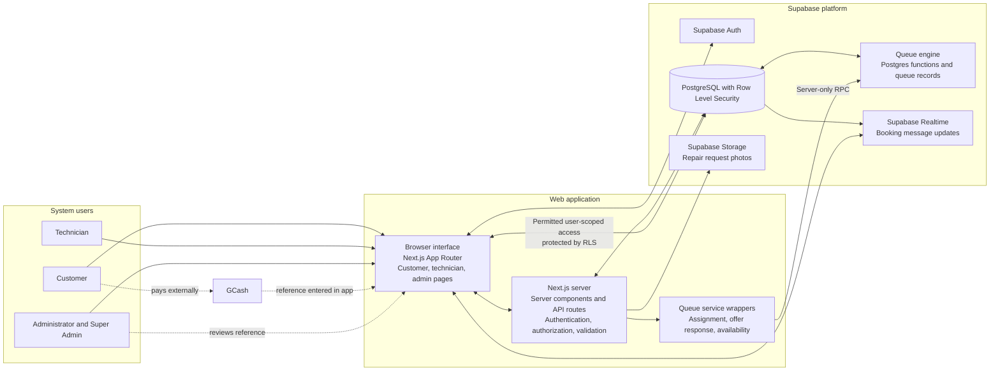
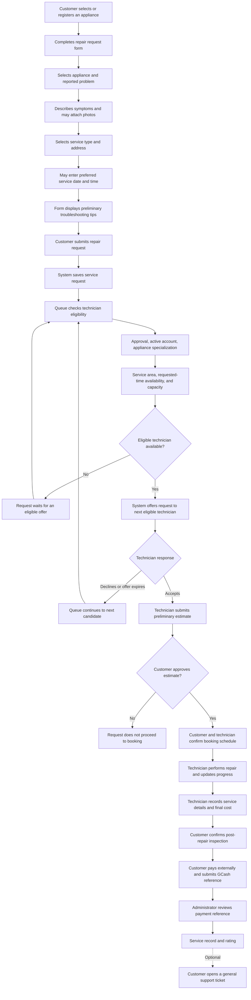

# SPARKServ manuscript corrections

> ## ⚠️ SUPERSEDED — read `MANUSCRIPT_REVISION.md` instead
>
> This file was written before several features were implemented, and **parts of it are now false.**
> It states that the system has **no multilingual intake** and **no warranty**, and both exist:
>
> * the intake matches English, Tagalog and Bisaya phrasings (`src/lib/issue-matching.ts`);
> * a completed repair records a workmanship warranty period and expiry date, printed on the job
>   order (`supabase/migration_service_warranty.sql`).
>
> It also lists **electric kettle** among the fifteen appliances (the catalogue has **induction
> cooker**, not electric kettle), references an eighteen-appliance catalogue that does not exist,
> and was written against a database state of eighteen migrations (there are now **nineteen**
> applied).
>
> `MANUSCRIPT_REVISION.md` replaces this file: it carries the same Chapter I replacement text
> corrected, adds Chapter III, the figures, a claim-to-evidence appendix and a defence Q&A.
> **Do not quote the claims below without checking them against `MANUSCRIPT_REVISION.md`.**

This draft replaces the descriptions and diagrams that do not match the current application source. It is based on the active project files under `src/` and `supabase/`. Keep the manuscript's existing research background and literature review where they remain relevant, but update any statements that present unimplemented functions as current system features.

## Chapter I replacement text

### Background of the Study

SPARKServ is a web-based appliance repair management system. Customers use the repair request form to provide appliance details, select a reported problem, describe the symptoms, optionally attach photos, choose a service arrangement, and provide a preferred service date and time. The form displays preliminary, safety-oriented troubleshooting tips when an appliance and problem have been selected. These tips are general guidance only and do not diagnose an appliance or replace inspection by a technician.

Submitting the form creates a repair request. The system then checks technicians through its queue process. Queue eligibility considers technician account and approval status, appliance specialization, service-area coverage, availability for the requested time, and workload capacity. The reported problem is stored with the request for technician review; the current queue does not match technicians to individual issue categories. Eligible technicians receive an offer through the queue and may accept or decline it. If an offer is declined or expires, the system can continue to the next eligible technician. If no technician is available, the request can remain waiting for an offer.

After a technician accepts a request, the technician may submit a preliminary estimate. The customer can review the estimate and proceed to booking. The technician updates the repair status and records service information. After the repair is marked complete and the customer confirms the inspection, the customer can submit an external GCash payment reference for administrator verification and rate the completed service. SPARKServ also provides messaging and general support tickets. The current system does not include Google Maps route integration, multilingual intake, or a separate post-repair warranty management workflow.

### System Objectives

Replace objectives that claim a separate Service Inquiry workflow, language translation, Google Maps routing, or a three-month repair warranty with the following:

SPARKServ aims to:

- Provide customers with a structured appliance repair request form that records appliance details, reported problems, photos, service preferences, and requested time windows.
- Display basic, safety-oriented troubleshooting guidance based on the selected appliance and problem, while making clear that the guidance is not a diagnosis.
- Distribute repair requests through a technician queue using technician approval, account status, appliance specialization, service-area coverage, requested-time availability, and workload capacity.
- Allow eligible technicians to receive and respond to request offers and, after accepting a request, submit a preliminary cost estimate.
- Allow customers to review estimates, proceed to service booking, follow repair progress, message the technician handling the repair, submit payment references for administrator verification, and provide feedback after completion.
- Provide appliance records, service history, general support tickets, and administrative views for service operations.

### Scope and Limitations

SPARKServ is a web-based appliance repair management system. Its customer repair form currently provides fifteen appliance choices: refrigerator, air conditioner, washing machine, television, electric fan, microwave oven, rice cooker, electric stove, induction cooker, water dispenser, electric kettle, vacuum cleaner, clothes dryer, freezer, and water heater. The form does not currently implement the eighteen-appliance catalog or five-category taxonomy described in the earlier manuscript.

The repair form combines appliance information, problem reporting, optional photos, service details, and preliminary troubleshooting guidance. Submitting the form creates a repair request directly; it does not create a separate Service Inquiry record or require customers to complete a separate inquiry stage first. The troubleshooting guidance is rule-based and limited to selected appliance and problem labels. It is not an automated diagnosis.

Technician queue decisions are based on queue position, technician eligibility, service-area coverage, availability for the requested time window, and capacity. The reported issue is available to the technician but is not currently used as an independent issue-to-technician matching criterion. A future booking does not, by itself, remove a technician from the queue; actual time conflicts and configured capacity are checked for each request.

Customers can enter the appliance's existing warranty status and expiry date. The current system does not record or enforce a three-month warranty for completed repairs. Warranty concerns may be raised through the general support-ticket process; the system does not determine whether a warranty claim is valid. The current source also does not implement Google Maps route guidance, multilingual service intake, or a dedicated complaint investigation workflow. Support tickets provide a general channel for customer concerns.

The system records GCash payment references for administrator review but does not process GCash transactions. Evaluation statements should remain in future tense until pilot testing has been completed and its participants, procedures, and results have been documented.

## Chapter II corrections

Literature about mapping, multilingual systems, appliance categories, or warranty programs may remain in the review of related literature when it supports the research context. Revise the synthesis and comparison matrix so these topics are not represented as implemented SPARKServ functions. Remove any system-cost calculation for Google Maps from the current implementation discussion unless route integration is added and its pricing assumptions are re-verified.

## Chapter III corrections

### Development technologies

Describe the current implementation as Next.js with TypeScript, Supabase/PostgreSQL, and Tailwind CSS. Remove Google Maps API from the implemented technology stack. It may be identified as a possible future enhancement, but not as an integrated service.

### Figure 3.2 Updated SPARKServ System Architecture

Replace the old architecture figure with this implementation-aligned view. The system architecture artwork is also available as `SPARKServ_System_Architecture.svg` in the project root.

### Technician queue criteria

Describe the queue criteria as technician account and approval status, verified appliance specialization, configured service-area coverage, availability for the requested service window, and workload capacity. The current queue stores the customer's reported problem for the technician to review but does not use issue category as a separate matching rule. Queue position is a fairness rotation. Accepting an offer consumes a turn and moves the technician to the end of that appliance queue. Declining or allowing an offer to expire does not normally consume the turn. A future booking only affects a request when the requested window conflicts or capacity is exceeded.

### Database design and diagrams

Update the ERD to reflect the implemented entities rather than the older conceptual entities named “Service Inquiries” and a single generic “Technician Queue.” The active schema uses `service_requests`, `technician_queue_state`, queue membership and event/offer structures, `estimates`, `bookings`, `messages`, `payments`, `service_history`, `ratings`, `support_tickets`, and related user, appliance, visit, and settings tables. Verify the final ERD directly against the latest `supabase/schema.sql` and queue migrations before submitting it.

Revise the use-case diagram to show the repair request form and its troubleshooting panel as one customer workflow. Keep payment reference submission and administrator verification, estimates, bookings, progress updates, messaging, ratings, and general support tickets. Remove use cases for route navigation, multilingual input, a separate inquiry record, formal three-month repair warranty handling, and complaint investigation unless those features are implemented.

Replace the old cross-functional workflow figure and its explanation with the diagram below. It represents the current source-level workflow and should be redrawn using the manuscript's required figure style before final submission.

### Figure 3.7 Updated SPARKServ Repair Request Workflow

**Figure explanation:** The customer submits one repair request form. Preliminary troubleshooting tips appear in that form and do not create a separate inquiry record or constitute a diagnosis. After submission, the system checks eligible technicians by appliance specialization, approval and account status, area, requested-time availability, and capacity. A technician who declines or does not respond to an offer may be followed by the next queue candidate. An accepted request proceeds to estimate review, booking, repair tracking, customer inspection confirmation, external payment reference submission, administrator verification, and feedback. General support tickets are available for concerns. The current system does not provide route navigation or a dedicated post-repair warranty workflow.

### Pilot testing and evaluation

Keep the testing plan in future tense only if the study is still at proposal stage. The test scenarios should cover the functions actually implemented: account access and role permissions, appliance registration, repair request submission, troubleshooting tips, queue offer and response, estimate approval, booking, progress changes, messaging, payment-reference submission and review, service history, ratings, and support tickets. Do not list multilingual intake, route guidance, issue-based technician matching, a formal repair-warranty workflow, or a dedicated complaint workflow as testable features until they exist. Once pilot testing is complete, replace the proposed schedule and future-tense statements with the actual participant count, sampling criteria, test dates, procedures, SUS results, and limitations.

## Final consistency checklist

- Search the full manuscript for “Google Maps,” “multilingual,” “Tagalog,” “Bisaya,” “18,” “three-month,” “warranty workflow,” “complaint,” “Service Inquiry,” and “unavailable.” Update every occurrence that describes implementation.
- Replace outdated queue explanations in the background, scope, use-case text, database text, workflow figure, and figure explanation.
- Redraw the revised workflow figure in the required capstone format and verify that its labels remain readable when printed.
- Rebuild the ERD from the active schema and migrations rather than editing the older conceptual diagram by hand.
- Confirm whether the current queue migration has been applied to the live Supabase database before describing the deployed system as operational. The repository progress note dated September 27, 2026 records that live migration and real-account walkthrough as pending at that time.
