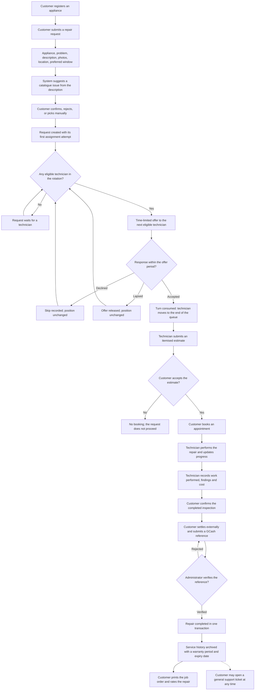
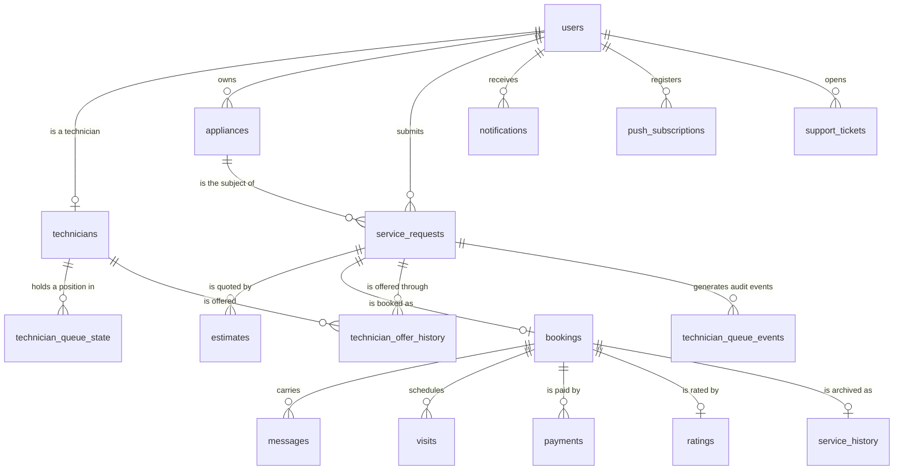

# SPARKServ — Manuscript Revision

**Drop-in replacement text for every section of the manuscript that describes the implemented
system.** Prepared against the active source tree (`src/`, `supabase/`, `scripts/`) on
31 October 2026. It replaces the earlier `MANUSCRIPT_CORRECTIONS.md`, which has itself gone out
of date: it states that the system has no multilingual intake and no warranty, and both now exist.

---

## How to use this document

| Part | Replaces |
| --- | --- |
| **Part 1** | Chapter I — Background, Objectives, Scope and Limitations, Significance, Definitions |
| **Part 2** | Pointers for Chapter II — what to keep, what to correct |
| **Part 3** | Chapter III — Methodology (algorithm, data model, security, accessibility, testing) |
| **Part 4** | The figures, as redrawable source, matching the real statuses and rules |
| **Part 5** | What must **not** be written yet (Chapter IV) |
| **Appendix A** | Every factual sentence in this document → the file or command that proves it |
| **Appendix B** | Defence Q&A — the questions a panel is most likely to ask |
| **Appendix C** | The numbers to quote, each with the command that re-proves it |

### The three labels used throughout

| Label | Means |
| --- | --- |
| **[BUILT]** | Implemented in the source tree; `npm run build` compiles it. |
| **[PROVEN]** | A test or command in this repository demonstrates it. The command is named. |
| **[NOT A FEATURE]** | Must not be described as existing. Each one states its boundary. |

### Read these two sentences before writing anything else

The two claims most likely to be challenged are the two the previous correction file got wrong:

* **"The system has no multilingual intake" is false.** It has **deterministic multilingual issue
  suggestion** — a reviewed phrase list in English, Tagalog, Bisaya and mixed forms
  (`src/lib/issue-matching.ts`). It is not machine translation, not an AI model, and not a
  diagnosis. It suggests; the customer confirms.
* **"The system has no warranty" is also false.** A completed repair carries a stored warranty
  period and expiry date, printed on the job order
  (`supabase/migration_service_warranty.sql`, `src/lib/job-order.ts`). What does **not** exist is a
  warranty **claims** workflow — no claim submission, no evidence upload, no refund path.

Both sentences are defensible only in the precise form above. Written loosely, either one becomes
a false claim about the system.

---

# Part 1 — Chapter I

## 1.1 Background of the Study

Household appliance repair in the Philippines is largely arranged through informal channels: a
neighbour's recommendation, a Facebook group post, a technician's mobile number written on a card.
These channels work, and they are how most repairs actually get done, but they leave the customer
with three unanswered questions before the visit — *who is coming into my home, what will this
cost, and what happens if the repair fails?* — and with almost no record afterwards. For the
technician, the same informality means work arrives unevenly: whoever is best known gets the calls,
and a capable technician with no network sits idle.

[INSERT CITATION: local literature on the informal appliance-repair sector and on consumer
confidence in home-service arrangements. Keep the manuscript's existing Chapter II sources here.]

This study addresses that gap by building SPARKServ, a web-based appliance repair management system
that carries a repair from the customer's first report through to a document the customer keeps.
The design premise is narrow and deliberate: **a repair should leave a record, and the decision of
who does the work should be explainable.** Every feature described below exists to serve one of
those two commitments.

**The intake.** A customer registers an appliance and reports what is wrong. The system offers
fifteen appliance types — refrigerator, air conditioner, washing machine, television, electric fan,
microwave oven, rice cooker, electric stove, induction cooker, water dispenser, air purifier,
vacuum cleaner, clothes dryer, freezer and water heater — each with a curated list of brands that
actually reach Philippine repair benches, and an "Other" option that opens a required free-text box
rather than storing a meaningless brand [BUILT]. The customer selects a reported problem from the
catalogue for that appliance, describes the symptoms in their own words, may attach photographs,
and pins the service location on an interactive map. The description is then matched against the
catalogue by a deterministic, multilingual matcher: if the words the customer used correspond to a
known issue, the system **suggests** that issue and asks them to confirm it. It never diagnoses, and
it never guesses when a description is ambiguous [PROVEN].

**The distribution.** Submitting the form creates a repair request. Eligible technicians are then
walked in a **strict rotation** — a queue — rather than by rating, popularity or seniority. A
technician is offered the request only if they are approved, active, specialised in that appliance,
within the service area, available for the requested time window, and within their workload
capacity. The offer is time-limited. If it is declined or lapses, the walk continues to the next
candidate. If nobody is eligible, the request waits, and the system says so [PROVEN].

**The execution.** A technician who accepts submits a preliminary cost estimate. The customer
reviews it and books a service appointment; the estimate the customer approved is the one that
authorises the work, and a later revision cannot silently inherit that approval [PROVEN]. The
technician updates progress, records what was found and done, and the customer confirms the
completed work. Payment is settled **outside** the system and evidenced by a GCash reference that
an administrator verifies; only a verified payment completes the repair [PROVEN].

**The record.** A completed repair produces a **job order** — one printable document carrying the
reference number, the appliance, the reported problem, the work performed, the itemised charges,
the verified payment, the sign-off, and the warranty period the repair carries [BUILT]. The warranty
is stamped when the repair is archived: thirty days of workmanship cover by default, configurable by
the operator, and frozen onto the record so a finished job keeps the terms it was sold under [BUILT].

**The awareness.** Eight kinds of event tell the party who did not act: a new message, a committed
appointment, a started repair, a finished repair, the customer's inspection sign-off, a
cancellation, an administrator's decision on a technician account, and a rating. Notifications
appear in the application and are also delivered as browser push notifications where the user has
allowed them [BUILT]. The application is installable and has a defined offline behaviour: a
navigation the network cannot answer falls back to a static offline page, and **no page is ever
served from a stale cache**, because in an application where a technician accepts a job and a
customer approves a price, a stale page is a wrong answer rather than a slow one [PROVEN].

**The gap this addresses.** Repair-booking tools in this market, where they exist, are contact
directories: they help a customer find a technician, and stop there. SPARKServ continues past the
introduction — to a fair and inspectable assignment rule, to a priced agreement, to a verified
payment, and to a warranty-bearing document. That continuation is the contribution this study
claims, and each link in it is individually testable.

## 1.2 What the System Does

The following is the complete functional inventory, grouped by who it serves. Each row is
implemented and compiled; the evidence column names where it lives.

| Function | Detail | Evidence |
| --- | --- | --- |
| Account and roles | Four roles — customer, technician, administrator, super-administrator — enforced at the route, the API and the database level | `src/middleware.ts`, `supabase/schema.sql` |
| Appliance registry | Fifteen appliance types, curated brand list per type, "Other" free-text escape, brand validation on every keystroke | `src/lib/appliance-brands.ts` |
| Repair request | Appliance, problem, description, photographs, service location with map pin, preferred date and time window | `src/components/RequestRepairWizard.tsx`, `src/lib/geo.ts` |
| Issue catalogue | Per-appliance problem list, each with reviewed safety-oriented preliminary checks and a disclaimer that the checks are not a diagnosis | `src/lib/appliance-issues.ts`, `src/lib/troubleshooting.ts` |
| Multilingual issue suggestion | Deterministic phrase matching in English, Tagalog, Bisaya and mixed forms; appliance-scoped; negation-aware; ambiguity is shown, never guessed | `src/lib/issue-matching.ts` |
| Technician queue | Strict rotation per appliance; eligibility, availability and capacity checked separately; time-limited offers; audited skips; reason-required administrative override | `supabase/migration_queue_redesign.sql`, `src/lib/queue.ts` |
| Estimate | Itemised labour, parts and other costs with scope; the customer accepts or declines; approval binds to one version | `src/lib/estimate-costs.ts`, `src/components/EstimateForm.tsx` |
| Booking | Appointment date, time and duration, with conflict and capacity enforcement at the database | `supabase/migration_atomic_booking.sql` |
| Progress tracking | Status timeline visible to customer, technician and administrator, with the status list defined once | `src/lib/booking-status.ts` |
| Messaging | Per-booking thread between customer and technician | `src/app/api/messages/route.ts` |
| Payment reference | Customer submits a GCash reference; administrator verifies or rejects with a reason; only verification completes the repair | `supabase/migration_rls_workflow_enforcement.sql` |
| Job order | Printable document with reference, appliance, problem, work performed, itemised charges, verified payment, sign-off and warranty | `src/lib/job-order.ts`, `src/components/JobOrderDocument.tsx` |
| Service warranty | Thirty-day workmanship period by default, configurable, stamped per repair and printed only when the record carries it | `supabase/migration_service_warranty.sql` |
| Technician disclosure | Photo, name, verification badge, rating from real reviews, completed jobs, experience and specialisations — no contact details | `src/lib/technician-profile.ts` |
| Notifications | In-app bell plus browser push, one entry point, sent after the write commits and never able to fail it | `src/lib/notifications.ts`, `src/lib/push.ts` |
| Ratings | One rating per completed booking; feeds the technician card but **not** the queue | `src/app/api/bookings/[id]/rating/route.ts` |
| Support tickets | General help requests, separate from repair requests | `src/components/SupportTicketsClient.tsx` |
| Administration | Queue monitor, job monitoring, payments queue, users, technicians, support tickets, system settings | `src/app/admin/`, `src/app/superadmin/` |
| Installable application | Web manifest, installable on a phone, defined offline fallback | `src/app/manifest.ts`, `public/sw.js` |
| Accessible interface | Light and dark themes, contrast verified against WCAG 2.1 AA by computation | `npm run test:design` |

## 1.3 What the System Deliberately Does Not Do

Every statement below is a **boundary**, not a shortcoming to be hidden. Stating them precisely is
what makes the rest of the manuscript true. Each boundary is enforced somewhere in the code, and a
panelist can check it.

| Not a feature | The precise boundary | Evidence |
| --- | --- | --- |
| **AI diagnosis** | The system never diagnoses a fault. It shows reviewed preliminary checks and suggests a catalogue issue for the customer to confirm. No model, no inference, no network call | `src/lib/issue-matching.ts`, `src/lib/troubleshooting.ts` |
| **Machine translation** | The matcher recognises a **reviewed list** of English, Tagalog and Bisaya phrases. It does not translate arbitrary text and makes no claim to understand every phrasing | `ISSUE_PHRASE_MAPPINGS`, `npm run test:issues` |
| **Route navigation** | There is an interactive map for **pinning the service location**, and the saved coordinate produces a Google Maps link for a human to open. There is no route optimisation, no distance ranking, no turn-by-turn navigation | `src/lib/geo.ts`, `src/components/LeafletLocationMap.tsx` |
| **Online payment gateway** | Payment is settled outside the system. The application records a GCash reference and an administrator verifies it. It never processes money, never holds a credential, never calls a payment API | `src/app/api/payments/[id]/route.ts` |
| **Warranty claims** | The system stores and prints the warranty **period** for a repair. There is no claim submission, no evidence upload, no approval or refund path for a claim | `supabase/migration_service_warranty.sql` |
| **Issue-based technician matching** | The queue matches on **appliance specialisation**, not on the reported issue category. Two appliances' technicians are separate rotations; individual fault types are not | `QUEUE-SYSTEM.md`, `technician_eligibility_failure()` |
| **Rating-based or "best match" ranking** | The queue is a strict rotation. Ratings, experience, completed-job counts and administrator preference are **never read by any queue function**. A ranking endpoint and a scored technician card existed and were deleted | `QUEUE-SYSTEM.md`, `PROGRESS.md` |
| **Automated messaging (SMS)** | Notification delivery is in-application and by browser push. There is no SMS gateway in the running product | `src/lib/push.ts` |
| **Fabricable history** | No client can insert into the queue audit trail; it is written only by privileged database functions | `supabase/migration_queue_redesign.sql` |

> **How to phrase this in the manuscript.** Write *"the system does not perform route optimisation
> or navigation"*, not *"the system has no maps"*. Write *"the system does not offer a warranty
> claims workflow"*, not *"the system has no warranty"*. The second form of each sentence is false,
> and a panelist who has seen the application will say so.

## 1.4 Statement of the Objectives

This study aims to **design, develop and evaluate a web-based appliance repair management system
that carries a household repair from the customer's first report to a warranty-bearing record, and
that distributes repair work by an explainable and fair rule.**

Specifically, this study aims to:

1. **Develop a structured repair intake** that records the appliance and its identifying details,
   the reported problem, the customer's own description, optional photographs, the service location
   and the preferred service window, and that suggests a catalogue issue from the description in
   English, Tagalog or Bisaya without ever presenting the suggestion as a diagnosis.
   *Testable as:* a submitted request of this shape is stored and readable by the assigned
   technician; a description in any of the three languages either yields a confirmable suggestion
   or yields none.

2. **Design and implement a technician assignment rule that is fair by construction**, in which
   eligibility is a rotation position, and in which approval status, account status, appliance
   specialisation, service-area coverage, requested-window availability and workload capacity are
   each evaluated separately rather than merged into a single "busy" flag.
   *Testable as:* a technician's turn is consumed exactly once, on acceptance; a decline, an
   expiry, a skip, a completion, a cancellation and a reschedule each leave the rotation
   unchanged; and a technician with a future booking is still offered work for a window that does
   not clash with it.

3. **Provide a priced, versioned agreement** in which a technician submits an itemised estimate and
   the customer's approval binds to that exact version, so a later revision cannot inherit an
   earlier approval.
   *Testable as:* a booking created from an accepted estimate records which estimate authorised it,
   and a superseded estimate cannot be used to book.

4. **Record the completed repair as a document the customer keeps** — a printable job order
   carrying the reference, the appliance, the reported problem, the work performed, the itemised
   charges, the **verified** payment, the sign-off and the warranty period — and refuse to print
   any of it that has not been verified.
   *Testable as:* an unverified or rejected payment prints a statement rather than a reference
   number; a repair with no recorded warranty date prints no warranty line.

5. **Make every event that changes somebody's next action reach them**, in the application and by
   browser push, without the notification ever being able to fail the write it describes.
   *Testable as:* each of the eight events notifies the party who did not act, the notification is
   sent after the write commits, and a delivery failure is logged rather than raised.

6. **Produce an interface that is legible and operable on a phone**, including a light and a dark
   theme whose text contrast is verified against WCAG 2.1 AA by computation rather than by
   inspection.
   *Testable as:* every text-and-background pair used by the application meets 4.5:1 in both
   themes, and interactive controls meet the minimum touch target.

7. **Evaluate the system against ISO/IEC 25010 software quality characteristics** using a
   user-acceptance test with the intended users.
   *Testable as:* instrument results reported in Chapter IV. **This objective is not yet
   discharged — see Part 5.**

## 1.5 Scope and Limitations

**Scope.** SPARKServ is a web-based appliance repair management system for the Philippine market.
It covers the full life of a repair request: intake, assignment, estimate, booking, execution,
inspection sign-off, payment verification, archival, warranty recording, feedback and general
support. It serves four roles — customer, technician, administrator and super-administrator — and
it is delivered as an installable web application.

The system covers **fifteen appliance types**, each with its own problem catalogue, reviewed
preliminary checks and curated brand list. The brand lists are drawn from brands that reach
Philippine repair benches, ordered by how commonly a repair involves them, with an "Other" option
that opens a free-text field so an unlisted brand is recorded rather than forced into a wrong
choice.

**Limitations.**

1. **Payment is external.** The system records and verifies a GCash reference. It does not process
   payments, and no financial credential passes through it. A verified reference is evidence that
   an administrator checked the transfer, not a settlement.
2. **The warranty is a recorded period, not a claims service.** A completed repair stores its
   warranty length and expiry date, and the job order prints them. No claim can be filed against
   it inside the system.
3. **Assignment is by appliance, not by fault.** A technician is eligible for the appliances they
   are specialised in. The queue does not consider which component failed, because that is
   established during inspection, after assignment.
4. **The issue suggestion is a reviewed phrase list.** It recognises approved English, Tagalog and
   Bisaya phrasings for catalogue issues. It is not a general language model, it does not translate,
   and a phrasing outside the list simply yields no suggestion rather than a wrong one.
5. **Matching is not ranking.** Because the queue is a strict rotation, the system cannot promise
   the "best" technician for a job. It promises a **fair** one, and it can show the reasoning that
   produced the assignment.
6. **Offline behaviour is a fallback, not offline operation.** Without a network the application
   shows a defined offline page. It does not queue writes or work offline, deliberately: serving a
   stale page for a price approval or a job acceptance would be worse than an honest failure.
7. **Evaluation is pending.** The system is built and tested at the code level. User acceptance
   testing and the ISO/IEC 25010 evaluation have not yet been conducted, and no claim about user
   satisfaction, perceived usability or productivity gain is made in this manuscript until they are.
8. **The deployed revision must be confirmed.** The repository contains the release; whether the
   hosted deployment is running exactly this revision must be verified and dated in Chapter III
   before the manuscript describes a live system.

## 1.6 Significance of the Study

**For customers.** The system answers the three questions an informal arrangement leaves open. The
customer knows who is coming — name, photograph, verification badge and rating from real reviews —
what it will cost, because the price is agreed before the visit, and what record remains, because
the completed repair produces a job order carrying a warranty period. Payment is verified by a
third party rather than asserted by the technician.

**For technicians.** Assignment by rotation means work is distributed by turn rather than by
reputation, which matters most to a competent technician who is new and has no network. The queue
is inspectable: a technician can see their position, see why they were skipped for a particular
request, and see that declining or lapsing an offer did not cost them their place. That
transparency is the difference between a rule technicians trust and one they work around.

**For repair enterprises.** The job order and the archived service history give a small enterprise
the documentation its customers ask for, and the queue monitor gives it visibility of work in
flight without a spreadsheet.

**For administrators.** Assignment decisions are audited: every skip records a reason, every
override requires a written justification and names the administrator who made it, and no client
can fabricate that history.

**For future researchers.** The system contributes a working example of a fairness rule
implemented **inside the database** rather than in application code, with the queue's invariants
provable by SQL tests — and an accessibility method in which contrast is verified arithmetically in
both themes rather than judged by eye in the one the developer prefers.

## 1.7 Definition of Terms

The queue vocabulary below is the part of the manuscript most likely to be written loosely. Five
concepts that sound similar are deliberately kept apart, because merging them is the defect the
current design exists to remove.

| Term | Operational definition |
| --- | --- |
| **Queue position** | A technician's place in one appliance's rotation. It answers *whose turn is it*, and it determines **fairness**. A technician sits in a separate queue for each appliance they are specialised in. |
| **Eligibility** | Whether a technician may take a particular request at all: approved account, active status, correct appliance specialisation, service-area coverage, no suspension, no live offer already held, and no clash with the requested window. |
| **Availability** | Whether a technician can work **the requested time window specifically**. It is evaluated per request. A technician with a future appointment is *available* for a window that does not overlap it. |
| **Capacity** | Whether accepting would overload the technician. Three limits apply together: daily hours (default 8), concurrent jobs (default 2) and jobs per day (default 4). |
| **Assignment** | Who actually took the job. Recorded as an accepted status on the repair request, not inferred from a queue position. |
| **Offer** | A time-limited invitation to one technician, valid for a configured period (default 15 minutes). An unanswered offer lapses and the walk continues. |
| **Offer lapse (expiry)** | The state of an offer whose period passed without a response. A lapsed offer does not change the technician's position, and the system releases it rather than letting it block later requests. |
| **Turn** | One technician's single use of their queue position, consumed **when they accept a job** — and only then. |
| **Rotation** | The rule that a technician who accepts a job moves to the end of that appliance's queue. Everything else — declining, lapsing, being skipped, completing, cancelling, rescheduling — leaves the position unchanged. |
| **Skip** | A technician passed over for **one request** because a specific condition failed (schedule clash, capacity, unavailability, outside the service area, already holding an offer). A skip is recorded with its reason and does **not** move the technician's position. |
| **Administrative override** | A position change made by an administrator inside the rotation, which requires a written reason and records the acting administrator in the audit trail. |
| **Estimate** | A technician's itemised quotation — labour, parts, other charges and the scope of work. The customer accepts or declines it. |
| **Estimate version** | One submission of an estimate. An approval binds to a specific version, so a later revision cannot inherit an earlier approval. |
| **Job order** | The printable document a completed repair produces: reference number, appliance, reported problem, work performed, itemised charges, verified payment, sign-off and warranty period. |
| **Service warranty** | The workmanship period recorded against a completed repair — 30 days by default, configurable by the operator — stored with its expiry date so a finished job keeps the terms it was sold under. |
| **Service history** | The archived record of a completed booking, including the warranty the repair carries. |
| **Verified payment** | A GCash reference that an administrator has checked and confirmed. Only a verified payment completes a repair; the job order prints a verified reference and never an unverified one. |
| **Issue suggestion** | A catalogue issue proposed to the customer because their own description matched a reviewed phrase. It is always presented for confirmation and is never a diagnosis. |
| **Progressive web application** | An installable web application with a defined offline fallback. It does not operate offline and does not serve cached pages. |
| **Service area** | The coverage a technician declares; a request outside it is skipped for that technician only. |

---

# Part 2 — Chapter II: what to keep and what to correct

The manuscript's existing review of related literature remains usable. Only the places where it
describes *this system* need correction. Four specific items:

1. **Localisation.** If the review argues that Filipino users are underserved by English-only
   interfaces, that argument now has a matching implementation and should be cited as such: the
   intake recognises English, Tagalog and Bisaya phrasings. Keep the literature; connect it to
   `src/lib/issue-matching.ts` instead of leaving it as an unaddressed gap.
2. **Fairness in work distribution.** If the review discusses reputation-based or rating-based
   matching in service platforms, this is the place to state the design decision explicitly: the
   system does **not** rank, and the review's discussion of ranking becomes the reason for that
   choice rather than a feature list.
3. **Consumer documentation and warranty.** The job order and the recorded warranty period answer a
   regulatory expectation that repair work be documented. Cite the specific instrument you rely on
   (the manuscript previously referenced DTI accreditation and PD 1572 / RA 7394); the system now
   produces the artefact that expectation describes.
4. **Anywhere the review says "the proposed system will…"** — change the tense. The system exists.

**Delete on sight:** any sentence in Chapter II or III stating that the system has no multilingual
intake, no warranty, no notification system, or that it ranks technicians by rating.

---

# Part 3 — Chapter III: Methodology

## 3.1 Research Design

This study uses a **developmental research design** with an iterative build-and-evaluate cycle,
supported by two evaluation frames:

* **Functional evaluation** by automated test suites — the queue's invariants are asserted against
  a real PostgreSQL instance, and the application's rules are asserted against the real modules.
* **User evaluation** against **ISO/IEC 25010** quality characteristics, using a user-acceptance
  test with the intended users (pending — see Part 5).

The development followed the repository's own documentation discipline: every behavioural rule is
written down (`QUEUE-SYSTEM.md`), tested (`scripts/tests/`, `scripts/test-queue-sql.mjs`), and only
then relied upon. Where a rule could not be tested, the manuscript says so rather than implying
coverage.

## 3.2 Requirements Elicitation

Requirements were established from three sources: the workflow of a household repair as it is
actually arranged in the locality, the constraints of the market (cash and GCash settlement,
patchy mobile connectivity, mixed-language descriptions of faults), and the needs of the three
parties in a repair — the customer who wants accountability, the technician who wants fair work,
and the operator who wants visibility.

The resulting requirements were expressed as invariants wherever possible, because an invariant can
be tested and a feature cannot. Three examples that shaped the design:

* *A future booking must never make a technician unavailable.* A technician with a Saturday
  appointment is still the right person for a Wednesday-morning repair.
* *Only acceptance consumes a turn.* Otherwise a technician is punished for being honest about
  unavailability.
* *A price approval authorises exactly one version of one estimate.*

## 3.3 System Architecture

SPARKServ is a **Next.js 14** application (App Router, React 18, TypeScript 5.5) on **Supabase**
(PostgreSQL, authentication, storage and row-level security). It is deployed as a single web
application with server-rendered pages and route handlers; the interface is built with Tailwind CSS
and is installable on a phone as a progressive web application.

The architecture is deliberately three-layered, and the most important statement about it is
**where the queue decision lives**:

| Layer | Responsibility |
| --- | --- |
| **PostgreSQL (Supabase)** | The **only** place that decides who gets work. Queue tables, the assignment, response, expiry and eligibility functions, the row and advisory locks, and row-level security all live here. |
| **Server logic** | Typed wrappers over the database functions, the time-window and capacity helpers, and the route handlers that authenticate, validate and then call a function with a service-role client. |
| **Interface** | Server components read and render; client components handle the interactive steps — responding to an offer, overriding a position, the wizard steps, countdowns. |

Four rules follow from that layering, and each is enforced:

1. **The queue is never computed in the interface.** The client-side queue module contains no
   ordering logic; it groups and labels the rows the database returned, in the order it returned
   them. The screen therefore cannot disagree with the assignment engine, because both read the
   same rows in the same order.
2. **Clients cannot mutate the queue.** The mutating functions are revoked from the anonymous and
   authenticated database roles. The only write path from a browser is a route handler that
   authenticates the caller and then calls the function with a service-role client. The single
   exception, the administrative override, requires a written reason and writes an audit row.
3. **The audit trail cannot be fabricated.** The queue event table has no client insert path; only
   privileged functions write it.
4. **The service-role credential never reaches the browser.** It is created in a server-only module
   and passed only to server code; client components receive plain data as properties.

**Request lifecycle.** A submitted repair request is created together with its first assignment
attempt in a single API call. The database walks the rotation, and either creates an offer or marks
the request as waiting. A scheduled job runs every five minutes in production to lapse expired
offers, re-match the requests they blocked, and refresh operational statuses. Crucially, the
assignment walk also releases already-expired offers *before* it runs, so a lapsed offer can never
freeze the rotation even if the scheduled job is late — the queue does not depend on a timer for
correctness.

## 3.4 Data Model

The schema is delivered in two equivalent forms, which is deliberate:

* **`supabase/schema.sql`** builds the complete database from nothing — used by the test harness to
  construct a real PostgreSQL instance in-process and assert the queue's behaviour against it.
* **`supabase/migration_*.sql`** brings an existing project to the same state, in order. **Nineteen
  numbered steps are tracked and applied**; `npm run db:check` verifies against the live project
  which of them are present, per object, and exits non-zero if any is missing.

The tables, grouped by what they serve:

| Group | Tables | Purpose |
| --- | --- | --- |
| **Identity** | `users`, `technicians` | Application profile and role (`customer`, `technician`, `admin`, `super_admin`); technician specialisations, coverage, capacity limits and the cached operational status. |
| **Customer property** | `appliances` | The appliances a customer owns, referenced by their repair requests. |
| **The repair** | `service_requests`, `estimates`, `bookings` | The request and its reported problem; the itemised quotation and its versions; the confirmed appointment. |
| **Delivery** | `messages`, `visits`, `payments`, `ratings`, `service_history` | The per-booking thread; scheduled visits; the payment reference and its verification; the customer's rating; the archived completion record carrying the warranty. |
| **The queue** | `technician_queue_state`, `technician_queue_events`, `technician_offer_history` | The rotation (one row per technician per appliance, carrying the position and the last time the turn was consumed); the append-only audit trail; the history of every offer made and how it ended. |
| **Awareness** | `notifications`, `push_subscriptions` | The in-application notification, and the browser push endpoints a user has registered. |
| **Configuration** | `system_settings` | Operator-controlled values: offer lifetime, decline policy, service timezone, model version, warranty period. |
| **Support** | `support_tickets` | General help requests, kept separate from repair requests. |

> **A naming correction for the manuscript.** Do not write that the queue is a table called
> `technician_queue_members`. No such table exists: the redesign added the membership columns to
> `technician_queue_state` rather than creating a second table that could disagree with it
> (`supabase/migration_queue_redesign.sql`). `PROGRESS.md` names it loosely; the schema is the
> authority.

**Enumerated types** carry the workflow: `user_role`, request status, booking status, estimate
status, payment status (`pending_verification`, `confirmed`, `rejected`), visit status and ticket
status. Booking statuses that still hold a technician slot are named in one place in the database
(`booking_status_holds_slot()`), and the application mirrors that same list in one place
(`src/lib/booking-status.ts`); the two are documented as a pair so a change to one prompts a check
of the other.

**Redrawing the ERD.** Rebuild the diagram from `supabase/schema.sql` rather than editing the older
conceptual diagram. At minimum the ERD must show: `users` → `technicians` (1:1), `users` →
`appliances` → `service_requests` → `estimates` → `bookings`, `bookings` → `messages` / `visits` /
`payments` / `ratings` / `service_history`, and `technicians` → `technician_queue_state` →
`technician_queue_events`.

## 3.5 The Technician Assignment Algorithm

Assignment is implemented as a single database function that walks one appliance's rotation in
position order. The algorithm is stated here in pseudocode, and the SQL implementation follows this
shape exactly.

```
assign_technician_to_request(request):
    lock the request row, and take a per-request advisory lock
        # so two concurrent attempts cannot both "win" the same request

    release any offer on this request whose lifetime has already passed
        # self-healing: a lapsed offer can never block the rotation,
        # even if the scheduled sweep has not run

    if request is already accepted, cancelled or completed:
        return unchanged

    refresh the membership of every technician specialised in this appliance

    for each candidate in this appliance's rotation, in position order:
        reason := eligibility_failure(candidate, request)
            # approved account, active status, correct appliance specialisation,
            # service-area coverage, not suspended, not already holding a live offer

        if reason is not null:
            record the skip with its reason
            continue                    # POSITION UNCHANGED

        if candidate cannot work the requested window:
            record the skip with its reason
            continue                    # POSITION UNCHANGED

        if accepting would exceed the candidate's capacity:
            record the skip with its reason
            continue                    # POSITION UNCHANGED

        create the offer, expiring in queue_offer_ttl_minutes
        record the offer event
        return offered(candidate)

    return waiting_for_technician
```

Two properties of that walk are worth stating explicitly, because both were defects that the
current design removes:

**A skip is about one request, not about the technician.** Every skip records
`old_position = new_position` in the audit trail. That single fact is how the system proves "still
in position, but not offered *this* request" — the distinction that a merged availability flag
destroys.

**A future appointment never removes a technician from the rotation.** There is no rule anywhere in
the schema or the application that derives unavailability from the existence of a booking. A
technician may hold a Saturday appointment, sit at position 2, and still be the correct person to
offer a Wednesday-morning repair to.

### What moves a position, and what does not

| Moment | Effect on the rotation |
| --- | --- |
| Specialisation added, or account approved | joins that appliance's queue at the **end** |
| **Offer accepted** | **turn consumed** — moves to the end of that appliance's queue |
| Offer declined | **no change** (the turn is kept by default) |
| Offer lapsed unanswered | **no change** |
| Skipped (clash, capacity, unavailable, outside area, already holding an offer) | **no change** — the skip applies to that one request |
| Repair completed | **no change** — the turn was spent at acceptance |
| Customer cancels after acceptance | **no change** — never a reset to the front |
| Appointment rescheduled | **no change** — only the booking moves |
| Specialisation removed, or account deactivated | leaves that queue; other queues untouched |
| Administrative override | moves within the rotation only, with a written reason, and is audited |

**The decline policy, and why it is a setting.** Declining an offer records the reason and passes
the request on *without* consuming the turn. The rationale is that the rotation should reward work
taken, not offers refused: a turn-consuming decline would penalise a technician for being
unavailable at one particular time, which is exactly the behaviour that pushes technicians away from
an honest answer. The alternative policy is implemented and audited, and switching it is a
configuration change (`queue_decline_consumes_turn`) rather than a code change — so the manuscript
can report the policy as a design decision rather than as an assumption.

**Concurrency.** The walk holds a row lock on the request and a per-request advisory lock, so two
simultaneous attempts cannot both assign it. The test suite proves this with three real database
connections rather than simulated timing: under concurrent acceptance there is exactly one winner.

**Correctness does not depend on the timer.** Offers expire by policy, and a scheduled job lapses
them, re-matches the requests they were blocking and notifies the affected technicians. But the
assignment walk releases already-expired offers itself before every walk, so a late or failed
scheduled job cannot freeze the queue. The timer is an optimisation, not the invariant.

## 3.6 Fairness by Design

The assignment rule is a **strict rotation**, and it deliberately ignores four things a service
platform would normally consider:

* ratings and review scores;
* experience and seniority;
* the number of jobs a technician has already completed;
* administrator preference.

Those fields exist on the technician record for **display and reporting** — the customer sees a
rating on the technician card, and the operator sees completed-job counts — but **no queue function
reads them**. A ranking endpoint, a scoring engine and a scored technician card were built earlier
in the project and then **deleted**, because a queue that ranks cannot also be a queue that rotates,
and the study's claim is fairness rather than optimisation. `QUEUE-SYSTEM.md` records that removal
as a rule rather than a history note, so it is not reintroduced by a later change.

This makes the fairness claim **falsifiable**, which is the point. Three properties can be measured:

1. **Turn order is respected.** A technician who has waited longest is offered work first, subject
   only to eligibility, availability and capacity.
2. **A turn is consumed exactly once, on acceptance.** No other event — a decline, a lapse, a skip,
   a completion, a cancellation, a reschedule — moves a technician down the queue.
3. **Work is not concentrated.** Over a sequence of requests, the distribution of jobs across
   eligible technicians can be compared against the distribution that a highest-rated or
   first-to-accept rule would produce, using a concentration measure such as the Gini coefficient.

Property 3 is the **fairness experiment** the study still owes. Its design — rotation versus
highest-rated versus first-to-accept, over a fixed workload, with the concentration of jobs
compared — is specified in `DEFENSE.md`. The experiment has not been run, and this manuscript
therefore **does not report its results**; Chapter IV is the place for them once they exist.

## 3.7 Authentication, Authorisation and Data Protection

**Authentication** uses Supabase Auth with email and password. Password recovery is implemented
through a verified recovery link: the callback route accepts only a recovery-type token, so a
signup or email-change token cannot be spent on a password reset.

**Authorisation is enforced at three levels**, and the database is treated as the boundary rather
than as a second opinion:

| Level | Mechanism |
| --- | --- |
| Route | Middleware maps path prefixes to permitted roles, so an unauthorised role never reaches a page. |
| API | Each route handler authenticates the caller and derives the acting role from the session, not from the request body. |
| Database | Row-level security on every table, plus `REVOKE EXECUTE` on every mutating queue function. A client-role attempt to write the queue is refused by the database even if a route is wrong. |

**Specific protections worth stating in the manuscript:**

* **Privilege escalation is blocked at the database.** A trigger refuses a change to a user's own
  role, so a crafted profile update cannot promote an account.
* **A repair can never be closed without a verified payment.** Completion happens inside the payment
  verification transaction, so a half-completed repair is impossible rather than merely unlikely.
* **Technician contact details are never published.** The published technician profile is a fixed
  shape — name, photograph, verification badge, rating, completed jobs, experience, specialisations
  — with no phone number, email address or street address. A customer reaches their technician
  through the booking thread, which keeps the conversation on the record.
* **The service-role credential is server-only.** It is created in a server module, never imported
  by a client component, and never returned in a response.
* **A job order is built with the customer's own credentials.** The document a customer prints is
  assembled with their session, scoped by an ownership predicate in the query, and row-level
  security refuses anything else a second time.
* **Error messages are not used as a debugging channel.** Administrative reads that fail are logged
  with the database code and the query name and **never with row-bearing fields**.

## 3.8 Multilingual Issue Suggestion

Customers describe faults the way they speak, and in this locality that is frequently Tagalog,
Bisaya, or a mix of either with English technical words. An intake that accepts only formal English
either loses that information or forces the customer to guess at a term they may not know.

The design response is a **deterministic, reviewed matcher** rather than a language model. It takes
the appliance the customer selected and the description they typed, and returns **one of three
outcomes**:

| Outcome | Meaning | What the customer sees |
| --- | --- | --- |
| **Match** | Exactly one catalogue issue has the most specific approved phrase in the text. | The issue is **suggested**, with the phrase that matched, and the customer confirms or rejects it. |
| **Ambiguous** | Two or more issues are equally specific. | Up to three candidates are shown and the customer chooses. Nothing is guessed. |
| **None** | Nothing recognisable. | The description is kept exactly as written, and the customer picks an issue manually or continues without the preliminary checks. |

The rules the implementation enforces, each pinned by a test:

* **Nothing is matched that is not in the catalogue for the selected appliance.** A phrase belonging
  to another appliance's issue can never fire. "Other" is never matched, because it is not a fault
  and therefore cannot be inferred.
* **Nothing is matched unless an approved phrase actually appears.** Matching is on word boundaries,
  so a phrase cannot match inside a longer word.
* **Phrases must be at least two words**, unless they are on a short list of distinctive single
  words that name exactly one fault and nothing else. This is what keeps generic words out — a
  single word meaning "problem", "broken" or "noisy" in general cannot drag the customer to a
  specific issue.
* **A negated occurrence is rejected.** A description that says the appliance is *not* leaking must
  not be matched to the leaking issue. The guard examines the token position before the match,
  trimming the prefix first so that a phrase which legitimately begins with a negation — "not
  cooling" — does not negate itself.
* **Both sides are normalised** for case, accents, apostrophes and spacing, so a phrase is written
  naturally once and recognised however the customer capitalises or punctuates it.
* **It is pure and synchronous.** No network call, no model, no database round trip, so the form
  never has to render a loading or stale state, and the same input always produces the same output.

**The honest limit, which the manuscript must state.** Coverage is exactly the reviewed phrase list.
The matcher does not translate arbitrary text, does not understand a phrasing outside its list, and
makes no claim to general language competence. Its value is that it is **inspectable and
auditable**: a reviewer can read every phrase it recognises, and the test suite fails if a phrase
refers to an issue that does not exist in the catalogue. A translation API would be less
predictable, would send the customer's description to a third party, and could not be tested this
way — which is the reasoning the manuscript should present, rather than claiming a capability the
system does not have.

## 3.9 Accessibility and the Design System

The interface ships a **light and a dark theme**. The theme is applied by a pre-paint script that
reads a stored choice from `localStorage` (`sparkserv-theme`). **Light is the default when nothing is
stored** — `prefers-color-scheme` is deliberately not consulted — so the correct theme is painted
before the first frame rather than after a white flash. The provider that persists an explicit choice
exists (`src/components/ThemeProvider.tsx`, `src/lib/theme.ts`), and `ThemeToggle` — in the site
navbar and the dashboard top bar — is the control, so a reader can switch at will. The manuscript
should describe a real, user-facing light/dark setting that defaults to light.

Accessibility was treated as a measurable property rather than a matter of taste, and this produced
a method worth reporting in the manuscript:

**Contrast is computed, not eyeballed.** A test (`npm run test:design`) parses the actual colour
tokens out of the application's stylesheet, resolves them into RGB values, and applies the **WCAG
2.1 relative-luminance formula** to every foreground-and-background pair the application actually
renders — body text on each surface, muted text on each surface, and each tonal "read-as-text"
colour on its tonal fill. Both themes are checked. The floor is **4.5:1 for text**, with a minimum
hairline contrast for borders so a panel edge cannot vanish into the fill beside it.

**Alpha is composited before measuring.** A faded colour is a different colour: text at 70% opacity
over a surface is not the same contrast as the solid colour. The test composites the alpha rather
than measuring the token, which is what made the original defect measurable at all.

**Why computation was necessary.** The defect this method exists to prevent was invisible in the
theme the developer happened to be using. Text painted white on the application's "surface" colour
is white on white in light mode — completely unreadable — and every faded text opacity between 30%
and 60% measured between **1.9:1 and 4.2:1**, all below the 4.5:1 requirement, while looking
entirely acceptable on a dark canvas. Because the system follows the operating system theme, both
defects were invisible on a development machine set to dark mode. Arithmetic catches them; a person
clicking around in the theme they prefer does not.

**The correction was systematic rather than local.** A one-off migration script normalised colour
usage across the source tree: sub-floor text opacities to a passing token, invisible borders to the
border token, focus rings drawn in the colour of the border they were meant to highlight to a
contrasting brand tint, 10-pixel type to a legible minimum, and fixed near-white tints to
theme-aware tokens. Three base tokens were adjusted so the arithmetic passes in both themes. The
script is dry-run by default and is comment-aware, so prose that mentions a colour is not rewritten.

**Beyond contrast.** Interactive controls meet the minimum touch target size, an install prompt
stands down on the immersive form routes so it cannot cover a submit button, and the map is isolated
in its own stacking context so it cannot paint over a sticky action bar.

**What the method cannot prove, and the manuscript should say so.** Contrast is measured pair by
pair in isolation. It cannot detect a colour that clashes with its neighbour, a panel edge that
disappears against an adjacent fill, or an element that covers another. Those require the manual
pass described in `TESTING.md`.

## 3.10 Notification Design

Eight events change what somebody must do next, and each one notifies the party who **did not act**:
a new message, a committed appointment, a started repair, a finished repair, the customer's
inspection sign-off, a cancellation, an administrator's decision on a technician account, and a
rating. Offer lifecycle events — a job offered, an offer lapsed — are notified in the same way.

The design rules, each pinned by a test:

* **One entry point.** Every notification goes through a single function that writes the
  in-application notification and fires the browser push in parallel. There is no second path that
  could drift.
* **Sent after the write commits, never before.** The write is the fact and the notification is the
  announcement; announcing first could announce something that then failed.
* **A failed notification can never fail the write.** Delivery failures are logged and swallowed. A
  bell that did not ring must never undo a repair that was recorded.
* **Sent with a service-role client.** A customer-role insert into the notification table is refused
  by row-level security — which is precisely how these events came to be silent before this was
  fixed.
* **The recipient is derived from the actor, not from the status.** Whoever pressed the button is
  not told what they just did; the other side is. One rule covers every transition, including a
  cancellation written by an administrator and one written by the customer.
* **The copy states the consequence where a technician would otherwise assume the worst.** The
  cancellation notice says the queue turn was **not** consumed, because a technician who believes a
  cancellation cost them their place stops accepting offers.

**Delivery channels.** In-application notifications appear in the notification bell. Browser push is
delivered through the Push API with VAPID keys; a device registers a subscription, and a
subscription the browser has since revoked is cleaned up rather than retried forever. If push is not
configured, the application logs a warning and continues — push is an enhancement, not a
dependency.

## 3.11 Testing Strategy

Testing is organised by **what each layer can actually prove**, and the manuscript reports a result
only for the layer that produced it. Nothing in this section is a user evaluation.

| Layer | Command | What it proves |
| --- | --- | --- |
| Queue behaviour against real SQL | `npm run test:queue-sql` | The queue's invariants, executed against a real PostgreSQL instance built from `supabase/schema.sql` — including concurrency, with three live connections rather than simulated timing. |
| Application rules | `npm test` (20 test files) | The real modules, imported and executed: the multilingual matcher, the troubleshooting catalogue, brand and appliance fields, the estimate arithmetic and its status rules, the job order, the technician disclosure, notification coverage, the progressive-web-application behaviour, the design system, and the technician's two assignment lists. |
| Live migration state | `npm run db:check` | Which migrations are applied to the live project, per object, against the real Supabase project. |
| Compilation and types | `npx tsc --noEmit`, `npm run lint`, `npm run build` | That the application compiles, that types are sound, and that every route resolves. |

**The invariants the SQL suite asserts**, section by section: a turn is consumed exactly once, on
acceptance; a decline leaves the position unchanged; a skip caused by a schedule clash leaves the
position intact; a booking on 30 January does not block a request for 24 January; an overlapping
booking skips only the technician who clashes; a technician can never hold two live offers;
concurrent acceptance produces exactly one winner; completion, rescheduling and cancellation do not
re-rotate; an administrative override requires a reason and is audited; and changing a technician's
rating or experience moves nobody in the queue.

**A note on how these tests are written, because it affects what they prove.** Several suites read
source files as text and assert properties of them — that a route imports and calls the notification
function, that the call appears *after* the write it describes, that a module never reads a contact
column, that no forbidden colour utility remains anywhere in the source. These are **wiring and
guardrail** checks, and they are honest about it: the repository has no route runner and no browser
harness, so what a route does *with the database* is covered by the SQL suite, and what it does
*with a browser* is not covered automatically at all.

**What the suites cannot prove**, and what the manuscript must therefore leave to Chapter IV:

* that a notification was actually delivered (push, or read by a human);
* that the interface is usable, understandable, or pleasant — contrast is measurable, comprehension
  is not;
* that the queue behaves identically under the live project's row-level security, because the
  in-process database has no authentication layer and therefore no JWT roles;
* that the deployed application is the tested revision.

## 3.12 Deployment

The application is deployed as a Next.js project with its database and authentication hosted on
Supabase. Configuration is by environment variables: the project URL and public key for the
application, a service-role key used only by server code, VAPID keys for browser push, and a secret
for the scheduled assignment job. The scheduled job is declared in `vercel.json` and runs every five
minutes.

**Two deployment facts the manuscript must state honestly, because the previous draft asserted the
opposite of both:**

1. **The live database is migrated; the deployed application must be confirmed.** `npm run db:check`
   verifies the migration state against the real project and passes. Whether the hosted deployment
   is running the same revision as the repository must be confirmed in the deployment dashboard and
   **dated in this section** before the manuscript describes a live system.
2. **The queue's live behaviour has not been exercised end to end.** A verification script exists
   (`npm run verify:queue`) but it creates and cleans up real records, so it must be run
   deliberately rather than as part of routine testing. Until it is, the queue's correctness rests
   on the SQL suite rather than on production observation — a distinction the manuscript should
   state rather than blur.

## 3.13 Ethical Considerations

The system handles personal data — names, contact email, service addresses, geographic coordinates,
photographs of appliances and, where a customer chooses to send one, of their home — and it must be
described with the care that implies.

**Data minimisation.** The system records what a repair requires and no more. A technician's
published profile carries no contact details, so the customer's route to their technician runs
through the booking thread, where it remains on the record. Photographs are attached to a repair
request, not collected as a profile.

**Purpose limitation.** Service coordinates exist to tell a technician where to go. They are not used
for route optimisation, distance ranking or any other inference, and the system has no such
capability to misuse. The coordinate is validated and rounded to a precision appropriate to a street
address rather than a person.

**Consent.** Users choose whether to receive browser push notifications; the permission is requested
by the browser and can be withdrawn. The user-acceptance test will be conducted with the informed
consent of its participants, who will be told what is recorded, what is measured and that they may
withdraw — the instrument and consent text are part of the UAT materials (Part 5).

**No real data in testing.** The test suites construct their own fixtures and never operate on live
customer records. The one script that does write to the live project is explicitly gated and run
deliberately, and it cleans up after itself.

**Least privilege.** The credential that can bypass row-level security exists only on the server. It
is used where a system-generated write is required — a notification, an assignment, a verification —
and never to serve a page or to assemble a customer's own document.

**Third parties.** The deployment relies on external services: the database and authentication host,
a map-tile provider for the location picker, and the browser push service. Each receives only what
its function requires, and the manuscript should name them rather than leaving their role implicit.
The multilingual matcher, by contrast, is entirely local: a customer's description of a fault is
never sent to a translation or language service, which is a deliberate design decision and a
defensible answer to a data-protection question.

**Fairness as an ethical commitment.** Distributing work by rotation rather than by rating is
presented here as an ethical design choice, not merely a technical one: it declines to concentrate
opportunity among technicians who already have reputational advantage, and it accepts the cost that
a customer may be assigned a technician who is not the highest rated, because the system can explain
why it chose them.

---

# Part 4 — Figures

Redraw each figure in the format the capstone requires. The sources below match the implemented
statuses and rules, so a figure redrawn from them cannot contradict the text.

## Figure 1 — Use case diagram (revised)

```
Actors: Customer, Technician, Administrator, Super-administrator

Customer
  ├─ Register and manage appliances            (15 types, brand list, "Other" free text)
  ├─ Submit a repair request                   (problem, description, photos, location, window)
  ├─ Receive and confirm an issue suggestion   (EN / Tagalog / Bisaya; never a diagnosis)
  ├─ Read preliminary troubleshooting checks
  ├─ Accept or decline an estimate
  ├─ Book a service appointment
  ├─ Track repair progress
  ├─ Message the assigned technician
  ├─ Confirm the completed inspection
  ├─ Submit a GCash payment reference
  ├─ Print the job order (incl. warranty period)
  ├─ Rate the completed repair
  └─ Open a support ticket

Technician
  ├─ Maintain profile, specialisations, service area, capacity
  ├─ View queue position per appliance
  ├─ Accept or decline an offer
  ├─ Submit a versioned, itemised estimate
  ├─ Update repair progress
  ├─ Record work performed, findings and cost
  └─ Message the customer

Administrator
  ├─ Approve or refuse a technician account
  ├─ Verify or reject a payment reference (with a reason)
  ├─ Monitor the queue, skip reasons and offer activity
  ├─ Override a queue position (written reason required; audited)
  ├─ Monitor jobs and support tickets
  └─ Manage users and system settings (incl. warranty period)

Super-administrator
  └─ Manage administrator accounts, activity and settings
```

## Figure 2 — System workflow (Mermaid source)



## Figure 3 — Queue offer sequence (Mermaid source)

```mermaid
sequenceDiagram
    participant C as Customer
    participant API as Server route
    participant DB as PostgreSQL
    participant T1 as Technician (next in rotation)
    participant T2 as Technician (following)

    C->>API: Submit repair request
    API->>DB: assign_technician_to_request()
    Note over DB: row lock on the request<br/>+ per-request advisory lock
    DB->>DB: release any already-expired offer (self-healing)
    DB->>DB: walk the appliance rotation in position order
    DB->>DB: evaluate eligibility, availability, capacity
    Note over DB: a skip records old_position = new_position
    DB->>T1: Offer created, expiring in queue_offer_ttl_minutes
    alt Technician accepts
        T1->>DB: respond_to_offer(accept)
        DB->>DB: consume the turn; move to the end of the queue
        DB->>C: Notified — a technician accepted
    else Technician declines
        T1->>DB: respond_to_offer(decline, reason)
        Note over DB: position unchanged
        DB->>T2: Offer created for the next candidate
    else Offer lapses
        DB->>DB: lapse the offer; position unchanged; request waits
        Note over DB: the next assignment walk re-matches it
    end
```

## Figure 4 — Entity relationship diagram (Mermaid source)



> `service_history` is where the warranty period and expiry date live, so the ERD should mark it as
> the completion record rather than as a secondary table.

---

# Part 5 — What Must Not Be Written Yet

Chapter IV reports results. Several of those results **do not exist yet**, and the honest manuscript
says so rather than filling the gap with plausible numbers. The following are placeholders that must
be replaced with real data before submission — or the corresponding claim must be removed.

| Required result | Status | What has to happen first |
| --- | --- | --- |
| **User acceptance test** — participant count, sampling criteria, test dates, procedures, task completion, observed difficulties | **Not conducted** | Recruit participants and run the sessions. This is calendar-bound; start early. |
| **ISO/IEC 25010 evaluation** — ratings for functional suitability, usability, reliability, performance efficiency, security, maintainability, portability | **Not conducted** | Build the instrument (a questionnaire mapped to the characteristics), run it with the UAT participants, and report the results with the computation used. |
| **SUS score** (if the manuscript uses it) | **Not collected** | Administer the instrument; report the score with its interpretation band. |
| **Fairness experiment** — rotation versus highest-rated versus first-to-accept, with the concentration of jobs compared (e.g. Gini) | **Designed, not run** | Run the experiment described in `DEFENSE.md` and report the measured distributions. Do not report expected results. |
| **Live queue verification** — the end-to-end behaviour of the queue against the real project | **Not run** | Run `npm run verify:queue` deliberately (it writes and cleans up real records) and record the date and outcome. |
| **Warranty trigger proof** — a completed repair carrying a stamped warranty date | **Not observed** | Complete one repair through the application and read the archived service history to confirm the warranty period and expiry date were written. |
| **Deployment confirmation** — the hosted revision matches the tested revision | **Unconfirmed** | Confirm in the deployment dashboard, then state the deployed revision and the date in §3.12. |
| **Real-device walkthrough** — the manual pass in `TESTING.md`, in both themes, on a phone | **Pending** | Walk the six screens listed in `TESTING.md` §4 in light and dark mode, on a phone, and record what was found. |

**Three sentences to delete if the corresponding result is not obtained:**

* *"Users found the system easy to use."* — only after a UAT.
* *"The rotation distributes work more evenly than rating-based assignment."* — only after the
  experiment, with the numbers.
* *"The system is deployed and in use."* — only after the deployment is confirmed, with the date.

---

# Appendix A — Claim to Evidence

Every factual claim in Parts 1–3 appears below with the file, test or command that supports it.
**How to use this appendix in a defence:** if a panelist questions a sentence, this table names the
page to open. If a claim is not in this table, treat it as unsupported and either evidence it or
remove it.

## A.1 The intake and the catalogue

| Claim | Evidence |
| --- | --- |
| Fifteen appliance types, derived from the issue catalogue so the two cannot drift | `src/lib/appliance-brands.ts` (`APPLIANCE_TYPES`), `src/lib/appliance-issues.ts` |
| A curated brand list per appliance, ordered by prevalence, with "Other" appended rather than stored | `BRANDS_BY_TYPE`, `brandOptionsFor()`, `scripts/tests/appliance-brands.test.mjs` |
| An unlisted brand is preserved as free text rather than dropped | `isListedBrand()`, `scripts/tests/appliance-brands.test.mjs` |
| Brand input is validated and capped on every keystroke | `sanitiseBrandInput()`, `cleanBrand()`, `MAX_BRAND_LENGTH` |
| Every catalogue issue has a reviewed preliminary guide, or is explicitly the "other" case | `scripts/tests/troubleshooting-guides.test.mjs` |
| No guide asks the customer to do anything unsafe; the disclaimer frames the steps as optional checks, not a diagnosis | `scripts/tests/troubleshooting-guides.test.mjs` |
| Service coordinates are validated, rounded and never trusted from the request body | `src/lib/geo.ts` (`toServiceCoordinates()`), `scripts/tests/appliance-fields.test.mjs` |

## A.2 The multilingual matcher

| Claim | Evidence |
| --- | --- |
| Matching is deterministic and covers English, Tagalog, Bisaya and mixed phrasings | `src/lib/issue-matching.ts`, `ISSUE_PHRASE_MAPPINGS`, `scripts/tests/issue-matching.test.mjs` |
| Only issues belonging to the selected appliance can match; "Other" never matches | `matchIssue()`, `scripts/tests/issue-matching.test.mjs` |
| A phrase must be at least two words unless it is on the distinctive-single-word list | `DISTINCTIVE_SINGLE_WORDS`, `scripts/tests/issue-matching.test.mjs` |
| A negated occurrence is rejected, and a phrase that begins with a negation does not negate itself | `isNegatedBefore()`, `scripts/tests/issue-matching.test.mjs` |
| An ambiguous description produces candidates rather than a guess | `MAX_AMBIGUOUS_CANDIDATES`, `scripts/tests/issue-matching.test.mjs` |
| The matcher never queries a database or a network service | `matchIssue()` is pure and synchronous; `scripts/tests/issue-matching.test.mjs` |

## A.3 The queue

| Claim | Evidence |
| --- | --- |
| Assignment is decided only in the database, never in the interface | `ARCHITECTURE.md`; `src/lib/queue.ts` contains no ordering logic |
| A turn is consumed exactly once, on acceptance | `npm run test:queue-sql` (rotation section) |
| A decline leaves the position unchanged | `npm run test:queue-sql`; `queue_decline_consumes_turn` default `false` |
| A skip caused by a schedule clash leaves the position intact, and the audit row proves it | `npm run test:queue-sql`; `technician_queue_events.old_position = new_position` |
| A future booking does not block an earlier, non-overlapping request | `npm run test:queue-sql` (30 January booking versus a 24 January request) |
| An overlapping booking skips only the technician who clashes | `npm run test:queue-sql` |
| A technician can never hold two live offers | partial unique index `uniq_active_offer_per_technician`; `npm run test:queue-sql` |
| Concurrent acceptance produces exactly one winner | `npm run test:queue-sql`, three live connections |
| Completion, rescheduling and cancellation do not re-rotate | `npm run test:queue-sql` |
| An administrative override requires a written reason and is audited | `npm run test:queue-sql`; `admin_queue_override` |
| Rating and experience never affect the queue | `npm run test:queue-sql`; `QUEUE-SYSTEM.md` |
| Clients cannot write the queue; the audit trail has no client insert path | `REVOKE EXECUTE` statements in `supabase/migration_queue_redesign.sql` |
| A lapsed offer cannot freeze the rotation even if the scheduled job does not run | `supabase/migration_offer_lifecycle.sql` (the walk releases expired offers first) |
| A cancelled request releases its live offer | `lapse_offer_on_cancel` trigger; `respond_to_offer()` refuses closed requests |
| Capacity limits are daily hours, concurrent jobs and jobs per day | `technician_capacity_failure()`; defaults 8 / 2 / 4 |
| The queue is not issue-based; it matches on appliance specialisation | `technician_eligibility_failure()`, `QUEUE-SYSTEM.md` |
| Customer-facing queue wording comes from one place | `customerAssignmentCopy()`, `scripts/tests/queue-copy.test.mjs` |

## A.4 Estimate, booking, payment, job order, warranty

| Claim | Evidence |
| --- | --- |
| An estimate is itemised — labour, parts, other — with a scope | `src/lib/estimate-costs.ts`, `scripts/tests/estimate-costs.test.mjs` |
| Approval binds to one version of one estimate | `ARCHITECTURE.md` rule 4; `supabase/migration_estimate_workflow.sql` |
| A booking records the estimate that authorised it | `bookings.estimate_id`; `supabase/migration_atomic_booking.sql` |
| Booking is atomic and enforces conflict and capacity in one transaction | `create_booking_atomic()`; `scripts/tests/booking-outcome-contract.test.mjs` |
| A booking whose technician is no longer qualified is refused at the moment it is written | `technician_qualification_failure()`, step 17 |
| A cancellation releases the technician's slot in the same transaction as the status change | `release_slot_after_booking_cancel` trigger, step 18 |
| Only a verified payment completes a repair, and completion is a single transaction | `confirm_payment()`; `supabase/migration_rls_workflow_enforcement.sql` |
| A rejected payment carries a reason and is surfaced to the customer | `supabase/migration_reject_payment.sql`; `src/app/api/payments/[id]/route.ts` |
| "Active booking" is defined once and shared, so two screens cannot disagree | `src/lib/booking-status.ts`; `scripts/tests/admin-list-guards.test.mjs` |
| The job order is a pure function over already-fetched rows, testable without a database | `src/lib/job-order.ts`, `scripts/tests/job-order.test.mjs` |
| An unverified or rejected payment is never printed on the job order | `scripts/tests/job-order.test.mjs` |
| A missing brand, model or serial is omitted rather than printed as null | `scripts/tests/job-order.test.mjs` |
| A repair with no estimate falls back to the amount the technician recorded | `scripts/tests/job-order.test.mjs` |
| The job order is assembled with the customer's own client, scoped by ownership | `loadJobOrder()`; `src/app/customer/bookings/[id]/receipt/page.tsx` |
| A warranty period is stored per completed repair, 30 days by default, bounded 0–3650 | `supabase/migration_service_warranty.sql`; `service_history_warranty_days_check` |
| The warranty is stamped for **every** writer of a completion, not only one function | `stamp_service_warranty` BEFORE INSERT trigger on `service_history` |
| A finished job keeps the terms it was sold under when the default later changes | `warranty_days` stored beside `warranty_until` |
| The job order prints no warranty line unless the record carries one | `JobOrder.warranty`; `scripts/tests/job-order.test.mjs` |
| A repair archived before the warranty existed claims no warranty | `warranty_until` is nullable by design |

## A.5 Notifications

| Claim | Evidence |
| --- | --- |
| One entry point writes the in-application notification and fires the push in parallel | `src/lib/notifications.ts` (`notify()`) |
| Eight events notify the party who did not act | `scripts/tests/notifications-coverage.test.mjs` across five routes |
| A message notifies the other participant | `src/app/api/messages/route.ts` |
| A committed booking is announced to both parties | `src/app/api/bookings/route.ts` (`notifyBookedAppointment`) |
| Status changes — started, finished, inspection sign-off, cancellation — notify the other side | `src/app/api/bookings/[id]/route.ts` (`notifyStatusChange`) |
| A rating notifies the technician | `src/app/api/bookings/[id]/rating/route.ts` |
| An administrator's decision notifies the technician | `src/app/api/technicians/[id]/approve/route.ts` |
| A payment decision notifies the customer | `src/app/api/payments/[id]/route.ts` |
| A job offer and an offer lapse notify the technician | `src/lib/assignment.ts` |
| The notification is sent **after** the write commits | `scripts/tests/notifications-coverage.test.mjs` (ordering assertions) |
| A failed notification cannot fail the write | `notify()` calls the push sender without awaiting it; failures are logged |
| Notifications are written with a service-role client because row-level security refuses a customer-role insert | `scripts/tests/notifications-coverage.test.mjs` |
| The cancellation copy states that the queue turn was not consumed | `scripts/tests/notifications-coverage.test.mjs` |
| Push subscriptions the browser revoked are cleaned up | `src/lib/push.ts` (handles 410 Gone) |
| Push is optional: without VAPID keys the application logs a warning and continues | `src/lib/push.ts`, `src/lib/enablePush.ts` |

## A.6 Technician disclosure

| Claim | Evidence |
| --- | --- |
| The published profile is a fixed shape: name, photo, verified badge, rating, completed jobs, experience, specialisations | `src/lib/technician-profile.ts` (`TechnicianProfile`) |
| No phone number, email address or street address is ever published | `scripts/tests/technician-profile.test.mjs` (the module never reads a contact column) |
| The rating is computed from real review rows, not from the cached column | `averageRating()`, `scripts/tests/technician-profile.test.mjs` |
| A technician with no reviews has **no** rating, never a zero | `formatRating()` returns `null`; `scripts/tests/technician-profile.test.mjs` |
| The verification badge is the same approval flag the queue uses | `verified: technician.approved`; `scripts/tests/technician-profile.test.mjs` |
| A missing record degrades to less detail rather than to invented zeros | `buildTechnicianProfile()`; `scripts/tests/technician-profile.test.mjs` |
| Nothing is disclosed before an offer is accepted | `scripts/tests/technician-profile.test.mjs` |
| The card is not the deleted ranking UI under a new name | `scripts/tests/technician-profile.test.mjs` |

## A.7 Security and authorisation

| Claim | Evidence |
| --- | --- |
| Roles are enforced at the route | `src/middleware.ts` |
| A user cannot change their own role | `protect_user_role` trigger → `prevent_role_change()` |
| Row-level security governs every table, with mutating queue functions revoked from client roles | `supabase/schema.sql`, `supabase/migration_rls_workflow_enforcement.sql` |
| The service-role credential is server-only | `src/lib/supabase/server.ts`; imported only by server modules |
| Administrative reads log a database code and a query name, never row-bearing fields | `scripts/tests/admin-list-guards.test.mjs` |
| A refused write is surfaced rather than appearing saved | `scripts/tests/admin-payments-queue.test.mjs`, `scripts/tests/admin-list-guards.test.mjs` |
| Password recovery accepts only a recovery-type token | `src/app/auth/callback/route.ts`; `scripts/tests/password-recovery.test.mjs` |
| A customer cannot read another customer's request, booking or job order | Ownership predicate in the query plus row-level security; `src/lib/job-order.ts` |

## A.8 Installable application and offline behaviour

| Claim | Evidence |
| --- | --- |
| The application is installable, with a web manifest and icons | `src/app/manifest.ts`, `public/icons/`, `scripts/tests/pwa.test.mjs` |
| The service worker caches **only** the offline page | `public/sw.js`; `scripts/tests/pwa.test.mjs` |
| No page or asset is precached, and no stale HTML is ever served | `public/sw.js`; `scripts/tests/pwa.test.mjs` |
| Only top-level GET navigations are intercepted; API calls, payloads, images and every write are left alone | `public/sw.js` |
| A failed offline install does not leave the application without a worker | `cache.add(...).catch(...)` in `sw.js` |
| Push notifications are shown and a click routes back into the relevant page | `public/sw.js` (`push`, `notificationclick`) |
| The install prompt stands down on the immersive form routes | `src/components/InstallPrompt.tsx`; `scripts/tests/pwa.test.mjs` |
| Icons are generated by a dependency-free script rather than committed as opaque binaries | `scripts/generate-icons.mjs`, `npm run icons` |

## A.9 The design system and accessibility

| Claim | Evidence |
| --- | --- |
| Contrast is computed from the real tokens with the WCAG 2.1 formula, in both themes | `scripts/tests/design-tokens.test.mjs` (`npm run test:design`) |
| The text floor is 4.5:1 and alpha is composited before measuring | same |
| No white-on-surface text, no white placeholder, no focus ring in the border colour, no sub-floor text opacity, no 10px type, no fixed near-white tint remains in the source | same (source guardrails) |
| Sub-floor text opacities measured between 1.9:1 and 4.2:1 before correction | same (the assertion that forced the change) |
| Three base tokens were moved so both themes pass | `src/app/globals.css`; `npm run test:design` |
| Colour usage was normalised systematically by a dry-run, comment-aware script | `scripts/normalise-ui-colours.mjs` |
| Interactive controls meet the minimum touch target | component sources; `scripts/tests/design-tokens.test.mjs` |
| The map is isolated so it cannot paint over a sticky action bar | `src/components/ServiceLocationMap.tsx` |

## A.10 Numbers, and how to re-prove each

| Number | Command | Expected |
| --- | --- | --- |
| Application test suite | `npm test` | 313 tests across 20 test files, 0 failures |
| Queue behaviour against real SQL | `npm run test:queue-sql` | 374/374 checks passed |
| Migration state against the live project | `npm run db:check` | exits 0; 19 steps applied; 79 checks passed |
| Types | `npx tsc --noEmit` | no output |
| Lint | `npm run lint` | no warnings or errors |
| Production build | `npm run build` | compiled successfully; 80 pages generated |
| Design system | `npm run test:design` | 12 tests, 0 failures |
| Multilingual matcher and guides | `npm run test:issues` | passes |
| Colour normalisation is idempotent | `node scripts/normalise-ui-colours.mjs` | reports 0 changes (dry run) |

## A.11 The technician's assignment lists

| Claim | Evidence |
| --- | --- |
| A closed request (completed or cancelled) is never listed as needing an estimate | `requestNeedsQuote()` in `src/lib/estimate-costs.ts`; `scripts/tests/estimate-costs.test.mjs` |
| A request whose estimate was already APPROVED is never listed as needing one | same — an accepted version is not "open", which is what the old inline rule mistook for "nothing sent yet" |
| A DECLINED version returns to the list as a re-quote; an approved one does not | `requestNeedsQuote()`, `scripts/tests/estimate-costs.test.mjs` |
| The pending list excludes closed requests in SQL from the same list the rule reads | `CLOSED_REQUEST_STATUSES` used in the query; `scripts/tests/technician-assignments.test.mjs` |
| The server refuses a quote on a closed request, so the screen must not offer one | `submit_estimate()` → `request_closed`; `src/app/api/estimates/route.ts` (HTTP 409) |
| A finished repair is archived with its warranty and is readable by the technician who did it | `service_history.technician_id` + the "relevant users view service history" policy; `/technician/past-jobs` |
| Past jobs publishes no customer contact detail, because a technician may not read a customer's profile | `scripts/tests/technician-assignments.test.mjs`; the `users` select policy |
| Past jobs is read-only and shows a repair archived before the warranty existed as carrying none | `scripts/tests/technician-assignments.test.mjs` |
| A cancelled appointment stays visible without being counted as completed work | `scripts/tests/technician-assignments.test.mjs` |

> **Re-run these the day before the defence, and quote the numbers you actually saw.** Every figure
> above is a property of the repository on a given day, not a permanent fact. If a number changed,
> the manuscript changes with it.


---

# Appendix B — Defence Q&A

The questions below are the ones this system most invites. Each answer is short, true, and points at
evidence. Where the honest answer is "not yet", the answer says so — a panel forgives a gap that is
acknowledged and punishes a gap that is concealed.

**1. "Isn't the multilingual feature just a keyword search? Isn't that weak?"**
It is a keyword search, deliberately, and it is the stronger choice here. It is appliance-scoped, so
a phrase belonging to another appliance's fault cannot fire. It refuses single generic words unless
they name exactly one fault. It rejects a negated occurrence, so "hindi tumutulo" is not matched to
a leak. When two issues are equally specific it shows the customer the candidates instead of
choosing. And every phrase it recognises can be read and audited. A model would be less predictable,
less testable, and would send the customer's description of their home to a third party.

**2. "Where does the 'fairness' claim actually live in the code?"**
In the database, in the assignment walk: candidates are visited in rotation order, and the only
event that consumes a turn is acceptance. There is no ranking function, no score, no preferred
technician path — and the earlier ranking endpoint, scoring engine and scored card were deleted. The
SQL suite asserts the rotation rules, including that changing a technician's rating or experience
moves nobody.

**3. "Show me that a technician with a future booking is still offered work."**
`npm run test:queue-sql` — the schedule section. A booking on 30 January does not skip a technician
for a 24 January request; only an actual overlap does, and only for the technician who overlaps. The
documented forbidden inference is `future_booking_exists ⇒ unavailable`, and it appears nowhere in
the schema or the application.

**4. "What happens if a technician ignores an offer?"**
It lapses after the configured period — 15 minutes by default — and the technician keeps their
position. The system releases the lapsed offer itself before every assignment walk, so a late
scheduled job cannot freeze the queue. The scheduled job exists to lapse, re-match and notify, not
to keep the queue correct.

**5. "Who verifies the payment, and can a repair be closed without one?"**
An administrator verifies the GCash reference, and a rejection carries a reason. Completion runs
inside the verification transaction, so a repair cannot be closed without a verified payment and a
half-completed repair is impossible. The job order prints the reference only when it is verified —
evidence nobody has checked is not evidence.

**6. "What does the warranty actually do?"**
It records a workmanship period against a completed repair — 30 days by default, operator-
configurable, stored with its expiry date, stamped for every writer of a completion, and printed on
the job order only when the record carries it. It is not a claims service; no claim can be filed in
the system, and the manuscript says so.

**7. "How do you know the interface is accessible?"**
By arithmetic, not by opinion. A test parses the real colour tokens, composites the alpha, and
applies the WCAG 2.1 relative-luminance formula to every pair the application renders, in both
themes, with a 4.5:1 floor. That method exists because the defect it caught — white text on a white
surface, and faded text measuring 1.9:1 to 4.2:1 — was invisible in the theme the developer was
using. What it cannot prove is how anything looks, and the manual pass covers that.

**8. "What have you not tested?"**
Three things, and they are named in the manuscript. Delivery of notifications has never been
observed end to end. Row-level security has never been exercised against the live project, because
the in-process test database has no authentication layer. And no user has used the system yet — the
user acceptance test and the ISO/IEC 25010 evaluation are outstanding.

**9. "Is the system deployed?"**
The database is migrated and verified against the live project. The deployment of the application
revision must be confirmed in the dashboard and dated in §3.12 before the manuscript describes a
live system. Until then the manuscript says the release is verified locally.

**10. "Isn't the fairness claim unproven without an experiment?"**
Correct, and the manuscript claims the **design** is fair by construction, not that it outperforms
alternatives. The rotation's properties are proven by test; the comparison against highest-rated and
first-to-accept, using a concentration measure such as the Gini coefficient, is designed and not yet
run. Reporting expected numbers would be fabrication.

**11. "Why is the queue in the database rather than in the application?"**
Because the decision must be atomic and must not be bypassable. The database holds the row lock and
the per-request advisory lock, so two concurrent attempts cannot both assign a request; it holds the
row-level security, so a client cannot write the queue; and it holds the audit trail, so history
cannot be fabricated. The interface renders what the database decided — it never decides.

**12. "What is the actual contribution?"**
Two things. First, a repair that leaves a **record**: a verified payment, an archived completion,
and a warranty-bearing document the customer keeps — where comparable tools stop at introducing a
customer to a technician. Second, a work-distribution rule that is **fair by construction and
provable by test**, implemented at the data boundary, with the trade-off stated openly: the system
promises a fair technician, not the highest rated one, and it can show why it chose them.

---

# Appendix C — One-page defence cheat sheet

## The numbers (re-run the day before; quote what you saw)

| | |
| --- | --- |
| Appliance types | **15**, each with a problem catalogue and a curated Philippine brand list |
| Application tests | **313** across **20** test files |
| Queue SQL checks | **374** |
| Migrations applied | **19** steps, **79** checks (`npm run db:check` exits 0) |
| Production build | compiles, **80** pages |
| Types and lint | clean |
| Design-system tests | **12** (contrast in both themes, plus source guardrails) |
| Contrast floor | **4.5:1** (WCAG 2.1 AA), computed from the real tokens |
| Offer lifetime | **15 minutes** by default, operator-configurable |
| Warranty | **30 days** by default, operator-configurable, 0–3650 allowed |
| Capacity defaults | **8** hours/day, **2** concurrent jobs, **4** jobs/day |
| Service timezone | `Asia/Manila` |

## The vocabulary (use these words precisely)

* **Rotation** — the fairness rule. **Turn** — consumed on acceptance only.
* **Eligibility / availability / capacity** — three separate checks, never one "busy" flag.
* **Skip** — for one request; the position does not move.
* **Estimate version** — approval binds to one version.
* **Verified payment** — checked by an administrator; the only thing that completes a repair.
* **Job order** — the document the customer keeps, including the warranty period.
* **Issue suggestion** — proposed from the customer's own words; never a diagnosis.

## Say this

* "The system suggests a catalogue issue and asks the customer to confirm it."
* "Assignment is a strict rotation, decided in the database, with eligibility, availability and
  capacity evaluated separately."
* "Payment is settled externally and evidenced by a verified GCash reference."
* "A completed repair carries a recorded warranty period, printed on the job order."
* "The rotation is fair by construction; the comparison against ranked assignment is designed and
  not yet run."

## Never say this

* ~~"The system has no multilingual intake."~~ — it does, in English, Tagalog and Bisaya.
* ~~"The system has no warranty."~~ — it records and prints one; it has no *claims* workflow.
* ~~"The system has no maps."~~ — it has a location picker; it has no route optimisation.
* ~~"The system matches the best technician to the job."~~ — it rotates; it never ranks.
* ~~"The system is deployed and in use."~~ — until the deployment is confirmed and dated.
* ~~"Users found it easy to use."~~ — until the UAT is run.

## The five things still owed

1. **User acceptance test** — recruit now; it is calendar-bound.
2. **ISO/IEC 25010 instrument** — build and administer it with the same participants.
3. **Fairness experiment** — rotation versus highest-rated versus first-to-accept (Gini of jobs).
4. **Deployment confirmation** — the hosted revision, dated in §3.12.
5. **Manual colour pass on a phone** — light and dark, per `TESTING.md` §4.

---

*This document was written against the source tree on 31 October 2026. If the code changes, this
document changes with it — Appendix A exists so that the manuscript can be checked against the
implementation rather than against memory.*


