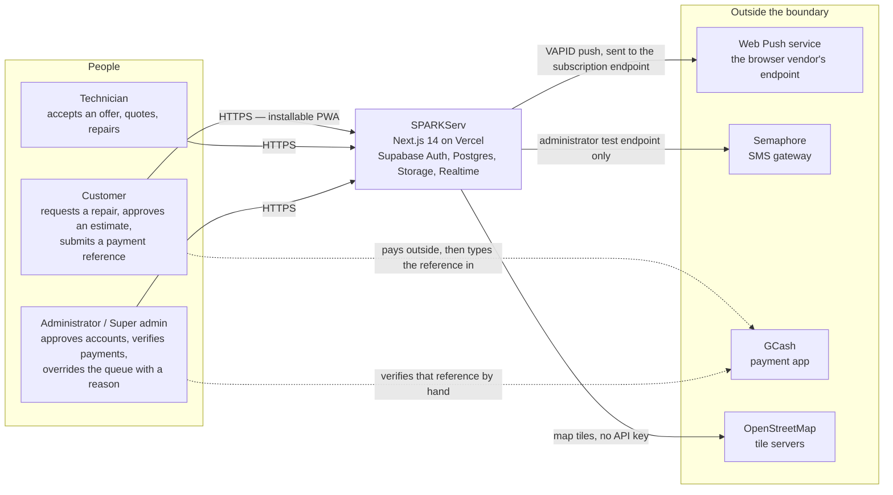
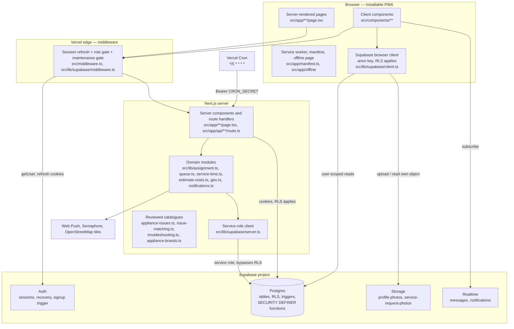
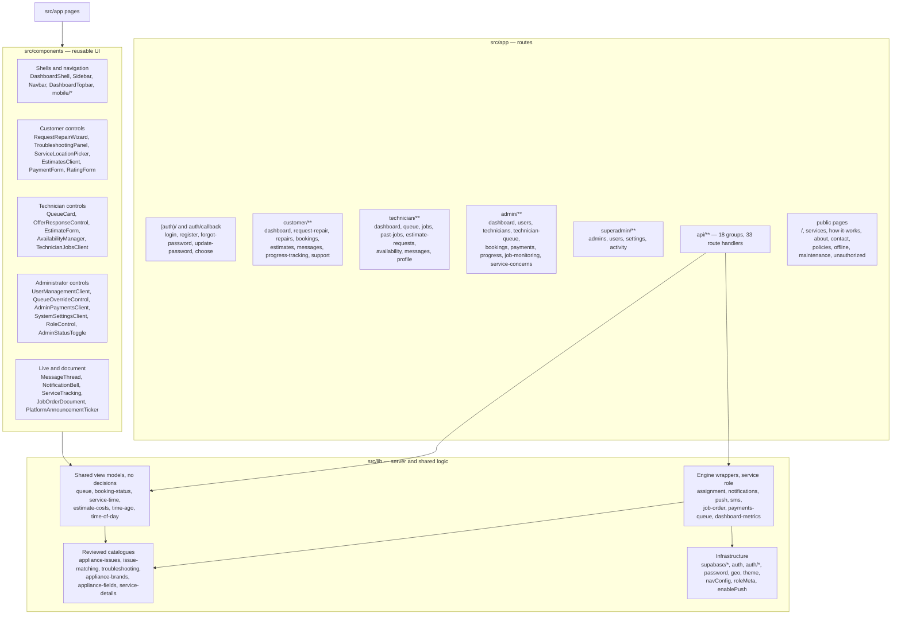
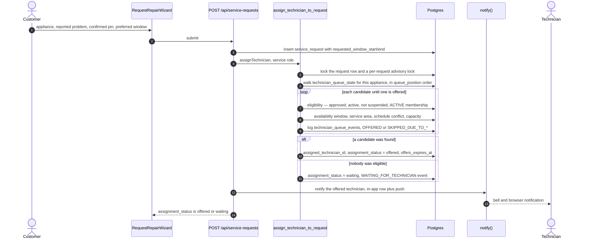
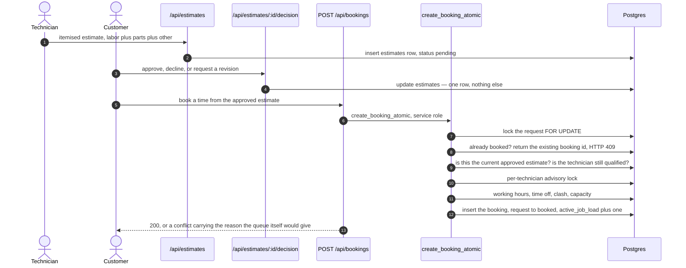
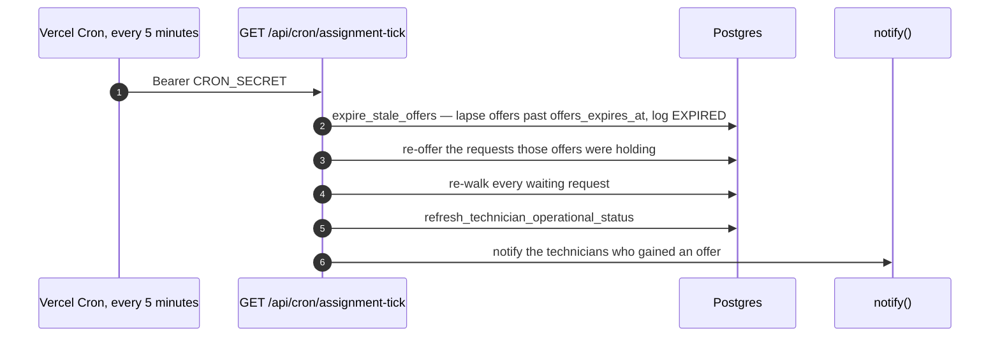
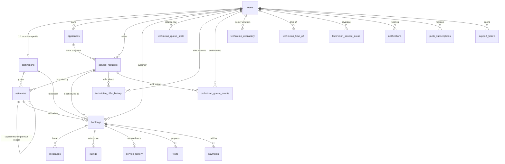
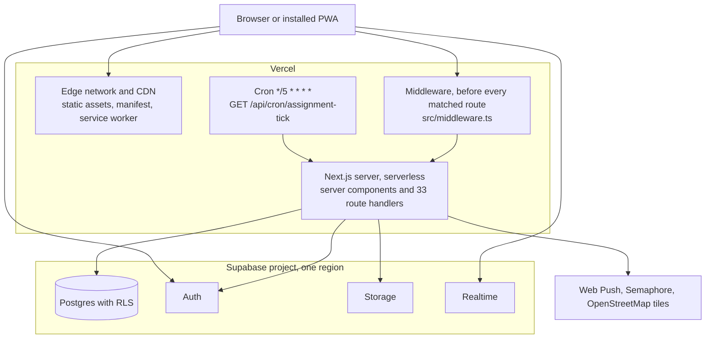

# SPARKServ — System Architecture

This document describes **how SPARKServ is built**: the actors, the containers, the
modules, the runtime flows, the data, the trust boundaries and the deployment. It is
the structural companion to the rest of the documentation set:

| Document | Answers |
| --- | --- |
| **this file** | What are the parts, and how do they fit together? |
| `ARCHITECTURE.md` | What are the rules the parts must not break, and why? |
| `QUEUE-SYSTEM.md` | How does the fairness rotation decide who is offered work? |
| `USER-FLOWS.md` | What does each actor do, step by step? |
| `DATABASE.md` | What is each table, column, function and trigger? (field-level detail) |
| `ROLES-AND-PERMISSIONS.md` | What may each role see and do? (capability matrix) |
| `TESTING.md` | How is each claim re-proved? |
| `PROGRESS.md` | What is finished, what is owed? |

Every box in every diagram below names a file that exists in this repository. If a box
cannot be traced to a path, the diagram is wrong and should be fixed.

## Scope

* **In scope** — the Next.js application in the repository root, the SQL in
  `supabase/`, the scheduled job in `vercel.json`, and the external services the
  application actually calls.
* **Database truth** — `supabase/schema.sql` builds a fresh database, and
  `supabase/migration_*.sql` carries the numbered steps that bring an existing project
  to the same state. `schema.sql` says so itself: *"REQUIRED: apply
  supabase/migration_queue_redesign.sql after this file"* (line 935), because the queue
  engine lives in that migration.
* **Out of scope** — the nested `SPARKServ/` directory. Git reports it as a modified
  gitlink (`git status --short` shows ` m SPARKServ`); it is an older copy of the same
  application, and its schema and components are **not** authoritative. Nothing in this
  document is drawn from it.

---

## 1. At a glance

| Aspect | Value | Evidence |
| --- | --- | --- |
| Runtime | Next.js 14.2.35, App Router, React 18.3, TypeScript 5.5 | `package.json` |
| Styling | Tailwind CSS 3.4 with a two-theme token system | `tailwind.config.ts`, `src/lib/theme.ts` |
| Platform services | Supabase: Auth, Postgres, Storage, Realtime | `src/lib/supabase/*` |
| Host | Vercel, single web application | `vercel.json`, `README.md` §5 |
| Scheduled job | `GET /api/cron/assignment-tick`, `*/5 * * * *`, `CRON_SECRET`-gated | `vercel.json`, `src/app/api/cron/assignment-tick/route.ts` |
| HTTP surface | 18 API route groups, 33 route handlers | `src/app/api/**/route.ts` |
| Database objects | 21 tables (17 in `schema.sql`, 4 in `migration_queue_redesign.sql`), 9 enum types, 44 RLS policies and 10 triggers in the base schema, 25 base functions + 27 queue-engine functions | `supabase/schema.sql`, `supabase/migration_queue_redesign.sql` |
| Storage buckets | `profile-photos` (public), `service-request-photos` (size- and MIME-limited) | `supabase/schema.sql`, `supabase/migration_service_request_photos_bucket.sql` |
| Browser push | Web Push with VAPID | `src/lib/push.ts`, `src/components/InstallPrompt.tsx` |
| SMS | Semaphore, reachable only from an administrator's test endpoint | `src/lib/sms.ts`, `src/app/api/admin/sms-test/route.ts` |
| Maps | Leaflet + OpenStreetMap tiles, no map API key or billing | `src/components/LeafletLocationMap.tsx`, `src/lib/geo.ts` |
| Offline | Installable PWA with a manifest, icons and an offline page | `src/app/manifest.ts`, `src/app/offline/page.tsx`, `scripts/generate-icons.mjs` |
| Proof harness | Node test runner + an in-process Postgres (PGlite) | `scripts/tests/*.test.mjs`, `scripts/test-queue-sql.mjs` |

---

## 2. Actors and roles

| Actor | Role value | May reach | Gate |
| --- | --- | --- | --- |
| Customer | `customer` | `/customer/**` | `src/middleware.ts` |
| Technician | `technician` | `/technician/**` | `src/middleware.ts` |
| Administrator | `admin` | `/admin/**`, and read access to `/customer/**` and `/technician/**` | `src/middleware.ts` |
| Super administrator | `super_admin` | `/superadmin/**` plus everything above | `src/middleware.ts` |
| The system itself | — | The queue engine, via the scheduled sweep | `src/app/api/cron/assignment-tick/route.ts` |

The field-level capability matrix — every capability against every role, plus what each
role must never see — is in `ROLES-AND-PERMISSIONS.md`. Two facts about the table above are
worth stating explicitly, because both are deliberate:

* The role is read from `public.users`, never from the request body, and
  `prevent_role_change()` (a `protect_user_role` trigger) stops a user from promoting
  themselves. `src/lib/auth.ts` exposes `getCurrentUser()` and `requireRole()` for
  server code, and `requireRole()` re-reads the row on every call.
* The privilege ladder is additive in one direction only: an administrator may *view* a
  customer's or a technician's surface, but no administrator shortcut exists inside the
  workflow — completing a repair still requires `confirm_payment()`, which re-reads the
  actor's role from the database.

`src/middleware.ts` also enforces **maintenance mode** for customers and technicians
only: when `system_settings.maintenance_mode` is `"true"`, they are redirected to
`/maintenance`, while administrators keep working so they can turn it back off.

---

## 3. Context view

Who and what SPARKServ talks to, and what crosses the boundary.



| Neighbour | Direction | Credential | If it is unavailable |
| --- | --- | --- | --- |
| Web Push service | outbound | `NEXT_PUBLIC_VAPID_PUBLIC_KEY` / `VAPID_PRIVATE_KEY` | `src/lib/push.ts` returns without sending; the in-app notification row is still written, and a revoked endpoint is deleted on `410 Gone` |
| Semaphore SMS | outbound | `SEMAPHORE_API_KEY`, `SEMAPHORE_SENDER_NAME` | Only the administrator test screen is affected — no business event sends a text message |
| GCash | none — the human moves the money | none | The reference is typed into a form; verification is a manual administrator decision |
| OpenStreetMap tiles | outbound | none | `src/components/ServiceLocationMap.tsx` renders a failure notice instead of a map, and the confirmed pin is unaffected |
| Vercel Cron | inbound | `CRON_SECRET` as `Authorization: Bearer` | The route refuses to run in production; offers lapse more slowly, and the next assignment walk releases them anyway (see §6.4) |

### What deliberately does not cross the boundary

* **No payment gateway.** GCash is not integrated. The customer pays in the GCash app and
  submits the reference; an administrator verifies it. No credential for GCash exists in
  the application.
* **No map API.** Tiles come from OpenStreetMap through Leaflet. There is no Maps key and
  no per-request billing.
* **No AI or translation service.** Troubleshooting is a finite, reviewed synonym list
  (`src/lib/issue-matching.ts`) over a canonical issue catalogue
  (`src/lib/appliance-issues.ts`).
* **No email pipeline.** The only mail is Supabase Auth's own password-recovery sender.
* **No SMS in any business flow.** Texting exists solely as the administrator's test
  endpoint.

---

## 4. Container view

The deployable and runtime pieces, and the credential each one holds.



| Container | Responsibility | Credential it holds |
| --- | --- | --- |
| Browser pages and client components | Render what the server returned; run the interactive steps — offer accept/decline, override, wizard steps, countdowns | none beyond the user's own session cookie |
| Browser Supabase client | Realtime subscriptions, file uploads, and user-scoped reads that RLS already limits | the public anon key |
| Middleware (edge) | Refresh the Supabase session, then allow or redirect by role prefix and maintenance mode | anon key, cookie-bound |
| Server components and route handlers | Authenticate, validate, then call the database or a domain module | the user's cookie for reads; the service role for mutations |
| Domain modules (`src/lib/*`) | Time windows, money rules, queue vocabulary, notifications, job-order rendering | none of their own — the caller supplies a client |
| Service-role client | The only writer of workflow state | `SUPABASE_SERVICE_ROLE_KEY`, server-only |
| Supabase Auth / Postgres / Storage / Realtime | Identity, the workflow's single source of truth, files, live updates | project keys |
| Vercel Cron | Keeps offers moving | `CRON_SECRET` |

### Three clients, three trust levels

This is the spine of the design, and it is worth reading as a table before reading any
route handler:

| Client | File | Key | What it can do |
| --- | --- | --- | --- |
| Browser | `src/lib/supabase/client.ts` | anon | Whatever RLS allows the signed-in user: their own rows, the queue *positions* (no addresses), their own offers, their own notifications |
| Server, cookie-bound | `src/lib/supabase/server.ts` → `createClient()` | anon, but with the request's cookies | Same as above, on the server — this is what server components read with |
| Server, privileged | `src/lib/supabase/server.ts` → `createServiceRoleClient()` | service role | Bypasses RLS entirely. Imported only by server modules, and only for the mutations listed in §8 |

Client components never receive a client with the service-role key. They receive plain
data as props.

---

## 5. Component view

How the source tree decomposes, and which layer each piece belongs to.



### 5.1 HTTP surface — 18 route groups

| Group | Handlers | Responsibility |
| --- | --- | --- |
| `admin` | `queue-override`, `sms-test` | Reason-required queue override; the SMS test endpoint |
| `appliances` | `route`, `[id]` | The customer's appliance register |
| `auth` | `ensure-profile`, `recovery` | Profile creation after signup; the password-recovery marker route |
| `bookings` | `route`, `[id]`, `[id]/rating` | Atomic booking creation, booking updates, the customer's rating |
| `cron` | `assignment-tick` | The scheduled sweep (§6.4) |
| `estimates` | `route`, `[id]`, `[id]/decision` | Itemised estimates and the customer's decision |
| `messages` | `route` | Posting and reading a booking's thread |
| `notifications` | `route` | The in-app notification list and read state |
| `payments` | `route`, `[id]` | Submitting a reference; the administrator's verify / reject decision |
| `profile` | `route`, `avatar` | Profile fields; avatar upload |
| `push-subscriptions` | `route` | Registering and removing a browser push endpoint |
| `service-requests` | `route`, `photos`, `[id]`, `[id]/offer-response` | Request intake with assignment, photos, request detail, offer accept/decline |
| `settings` | `route` | `system_settings` for administrators |
| `support-tickets` | `route`, `[id]` | **Service concerns** — general help kept apart from repair requests. The path is the TABLE's name (`support_tickets`), not the product's: see §7.2 |
| `technician-availability` | `route` | Weekly availability windows |
| `technicians` | `[id]/approve` | Approving a technician account |
| `users` | `[id]/role`, `[id]/status` | Role changes and account suspension |
| `visits` | `route`, `[id]` | Progress visits under a booking |

### 5.2 Domain modules — `src/lib`

The rule the module split encodes: **a decision lives in Postgres, a wrapper lives here,
a label lives in the UI.** Nothing in `src/lib` decides who gets work.

**Engine wrappers (service role; called only from route handlers)**

| Module | Responsibility |
| --- | --- |
| `assignment.ts` | Thin wrappers over the queue RPCs — assign, respond, expire, rematch, refresh operational status. Deliberately contains no decision logic. |
| `notifications.ts` | `notify()` writes the in-app notification row and fires a browser push in parallel; a push failure never fails the calling flow. |
| `push.ts` | `sendPushToUser()` — VAPID push to every endpoint the user registered, deleting the ones the browser has revoked (`410 Gone`). |
| `sms.ts` | The Semaphore client, reached only by the administrator test endpoint. |
| `job-order.ts` | Builds the printable job order for a completed repair. |
| `payments-queue.ts`, `dashboard-metrics.ts` | Administrator payment queue, and dashboard counters. |
| `query-rows.ts` | Normalising PostgREST's single-or-array shapes. |
| `appliances.ts`, `technician-profile.ts`, `assignment-coverage.ts`, `customer-actions.ts` | Shared server reads for the appliance register, technician profile, coverage and customer actions. |
| `auth.ts` | `getCurrentUser()` and `requireRole()`; an inactive account resolves to `null`. |
| `auth/recovery.ts`, `auth/recovery-marker.ts`, `auth/recovery-session.ts`, `password.ts` | The password-recovery handshake and password rules. |
| `signOut.ts` | Sign-out helper. |

**Shared rules and view models (used by both the UI and a route handler)**

| Module | Responsibility |
| --- | --- |
| `queue.ts` | The only queue read path. Groups the rows `technician_queue_snapshot()` returned, labels them and formats times — **no ordering logic**, and the customer-facing wording lives here (`customerAssignmentCopy`). |
| `booking-status.ts` | The application's mirror of `booking_status_holds_slot()`. The two are documented as a pair, so changing one prompts a check of the other. |
| `estimate-costs.ts` | The money and status rules shared by the estimate form and the estimate API. |
| `service-time.ts` | Preferred date/time → UTC window in the service timezone, plus the display formatter. |
| `geo.ts` | Coordinate rules and the external map link. |
| `time-ago.ts`, `time-of-day.ts` | Formatting helpers. |
| `navConfig.ts`, `roleMeta.ts` | Navigation structure and role labels. |
| `theme.ts`, `motion-variants.ts`, `enablePush.ts` | Theme tokens, animation variants, and the client-side push registration helper. |

**Reviewed catalogues (finite, reviewable, no model inference)**

| Module | Responsibility |
| --- | --- |
| `appliance-issues.ts` | The canonical issue id per appliance type. |
| `issue-matching.ts` | The synonym map (English / Tagalog / Bisaya) that *suggests* an issue; a suggestion is inert until the customer confirms it. |
| `troubleshooting.ts` | Preliminary checks keyed by appliance and issue. `scripts/tests/troubleshooting-guides.test.mjs` fails if a step asks the customer to open a unit, touch wiring or handle refrigerant. |
| `appliance-brands.ts`, `appliance-fields.ts` | Brands commonly serviced in the Philippines, and the per-appliance form fields. |
| `service-details.ts` | Copy for the public service pages. |

### 5.3 Components — `src/components`

| Group | Members | Kind |
| --- | --- | --- |
| Shell and navigation | `DashboardShell`, `DashboardTopbar`, `Sidebar`, `Navbar`, `DashboardHero`, `DashboardCard`, `QuickActions`, `Footer`, `BrandLogo`, `ThemeProvider`, `LoadingScreen`, `DashboardSkeleton`, `InstallPrompt`, `PlatformAnnouncementTicker`, `SupportBanner` | mostly server-rendered |
| Mobile shell | `mobile/MobileBottomNav`, `MobilePageHeader`, `MobileStatGrid`, `MobileStatTile`, `MobileSectionLinks`, `MobileRepairCard`, `MobileNotificationsList`, `CollapsibleSection`, `SignOutRow` | client, below the mobile breakpoint |
| Customer controls | `RequestRepairWizard`, `TroubleshootingPanel`, `ServiceLocationPicker`, `ServiceLocationMap`, `LeafletLocationMap`, `ServiceLocationCard`, `EstimatesClient`, `EstimateReviewCard`, `PaymentForm`, `RatingForm`, `CancelBookingControl`, `CustomerInspectionControl`, `RemoveRequestControl`, `ProgressTrackingClient`, `RequestDetailClient` | client |
| Technician controls | `QueueCard`, `OfferResponseControl`, `EstimateForm`, `AvailabilityManager`, `TechnicianJobsClient`, `ScheduleTimeline`, `BookingStatusControl`, `AssignedTechnicianCard`, `CustomerRatingForm` | client |
| Administrator controls | `UserManagementClient`, `RoleControl`, `AdminStatusToggle`, `ApproveTechnicianButton`, `QueueOverrideControl`, `AdminPaymentsClient`, `AdminServiceConcernsClient`, `AdminSmsTest`, `SystemSettingsClient`, `ServiceConcernsClient` | client |
| Admin filtering and warranty | `FilterDropdown` (a checkbox dropdown per facet: button variant for client lists, navigating variant for the server-rendered ones), `filterChipStyles` (the one filter-control recipe, in a non-client module so a server page can call it), `WarrantyBadge`; vocabularies and the multi-select rules in `src/lib/filter-options.ts`, the warranty reading in `src/lib/warranty.ts` | mixed |
| Live and documents | `MessageThread`, `NotificationBell`, `ServiceTracking`, `AssignmentStatusCard`, `JobOrderDocument`, `PrintButton`, `StatusBadge`, `RecentRepairTable` | mixed |

`src/components/motion/MotionProvider.tsx` wraps the animation library so that a
reduced-motion preference is honoured in one place.

### 5.4 Hooks — `src/hooks`

| Hook | Used for |
| --- | --- |
| `useUser` | The current profile in client components |
| `useRealtimeMessages` | Live updates on a booking thread |
| `useRealtimeNotifications` | Live notification arrival |
| `useUnreadNotificationCount` | The bell badge |
| `usePlatformAnnouncement` | The announcement ticker |

---

## 6. Runtime views

Four flows carry the system. In each one, the database is where the decision happens and
the route handler is a translator.

### 6.1 A request arrives and is offered



The technician never sees the address at this point. The offer screens read
`technician_pending_offers()`, which returns the caller's own offers **without** the
address, coordinates or customer identity — a policy keyed on `assigned_technician_id`
alone would leak the address while the request is still only `offered`.

### 6.2 The technician responds

```mermaid
sequenceDiagram
    autonumber
    actor T as Technician
    participant API as POST /api/service-requests/:id/offer-response
    participant R as respond_to_offer
    participant DB as Postgres
    participant N as notify()

    T->>API: accept or decline, with a reason for a decline
    API->>API: requireRole(technician) and ownership of the offer
    API->>R: respondToOffer, service role
    alt accept
        R->>DB: consume_queue_turn — TURN_CONSUMED then MOVED_TO_END for that appliance
        R->>DB: assignment_status = accepted
    else decline
        R->>DB: DECLINED with the reason; the position does not move
        R->>DB: re-walk the rotation and offer the next eligible technician
    end
    API->>DB: refresh_technician_operational_status
    API->>N: notify the customer, and the next technician on a decline
```

The asymmetry is the fairness rule: **accepting consumes a turn and moves that
technician to the end of the appliance's queue; declining does not.** A booking made
later moves no positions at all, because the turn was already consumed here.

### 6.3 Quote, approve, book



Three invariants back the single transaction, so no other writer can break them:
`uniq_active_booking_per_request` (one live booking per request; a cancelled row stays as
history), the `trg_booking_no_overlap` trigger (one technician cannot be in two places,
raising `23P01`), and the absence of any INSERT policy on `bookings` — a direct
`authenticated` insert is refused outright.

**Approval authorises exactly one version of one estimate.** The stored total is derived
from the itemised lines and checked by a constraint, so it can never disagree with the
breakdown the customer read. New chargeable work found during the repair is a **new
version** and needs its own approval.

### 6.4 The sweep, and what happens when it is late



The sweep is not what makes the queue correct. `assign_technician_to_request` releases
already-expired offers **before** it walks the rotation, so a lapsed offer cannot freeze
the rotation even if the sweep is late. Locally the same steps run through
`npm run cron:tick` (`scripts/run-assignment-tick.mjs`).

### 6.5 A booking is cancelled

Cancelling is the mirror of booking, and it is one transaction too. The `AFTER UPDATE`
trigger `release_slot_after_booking_cancel` calls `release_technician_slot()` — floored at
zero, so a repeat cancellation releases nothing — and refreshes the technician's cached
status in the same transaction as the status change. The Batch 1 trigger
`reopen_request_after_booking_cancel` returns the request to `quoted`, so the customer can
book again with the estimate they already approved. `booking_status_holds_slot()` is the
one definition of which statuses hold a slot, which is what makes a second cancellation,
or a `completed → cancelled` write, release nothing.

---

## 7. Data view

### 7.1 Two delivery forms

| Form | File(s) | Used by |
| --- | --- | --- |
| Fresh install | `supabase/schema.sql`, then the queue migration | A new Supabase project. The file states the dependency at line 935: *"REQUIRED: apply supabase/migration_queue_redesign.sql after this file"*, because the queue engine lives in that migration. |
| Upgrade in place | `supabase/migration_*.sql`, in order — 19 tracked steps | An existing project. `npm run db:check` (`scripts/check-migration-state.mjs`) verifies each step object-by-object against the live database and exits non-zero if one is missing. |

`npm run test:queue-sql` builds a real Postgres in-process (PGlite), loads
`scripts/sql-harness.sql` (stand-ins for `auth.users`, `auth.uid()`, `storage.*` and the
`anon` / `authenticated` / `service_role` roles), then applies `schema.sql` **and** the
tracked migrations — each run twice, which is how idempotency is proved rather than
assumed.

Column-by-column detail, table by table and function by function, lives in `DATABASE.md`.
This section is the *shape* of the data — enough to read the diagrams and the flows above —
not a field list.

### 7.2 Tables — 21, grouped by what they serve

| Group | Tables | Purpose | Defined in |
| --- | --- | --- | --- |
| Identity | `users`, `technicians` | The application profile and role; the 1:1 technician record with specialisations, coverage, capacity limits and the cached operational status | `schema.sql` |
| Customer property | `appliances` | The appliances a customer owns, which repair requests point at | `schema.sql` |
| The repair | `service_requests`, `estimates`, `bookings` | The reported problem and its requested window; the itemised quotation and its versions; the confirmed appointment | `schema.sql` |
| Delivery | `messages`, `visits`, `payments`, `ratings`, `customer_ratings`, `service_history` | The per-booking thread; progress visits; the payment reference and its decision; the customer's rating of the technician and the technician's rating of the CUSTOMER (two tables, so neither average can be built from the other's opinions — step 21); the archived completion record that carries the warranty | `schema.sql`; `customer_ratings` in `migration_customer_ratings.sql` |
| The queue | `technician_queue_state` (one row per technician **and** appliance type, keyed `(technician_id, appliance_type)`, carrying `queue_position` and `last_assigned_at`), `technician_offer_history`, `technician_queue_events` (append-only audit with no client insert path) | The rotation, and the record that makes "why was this technician skipped?" answerable | `technician_queue_state` and `technician_offer_history` in `schema.sql`; `technician_queue_events` in `migration_queue_redesign.sql` |
| Technician configuration | `technician_availability` (weekly windows, `weekday` 0–6 in the service timezone), `technician_time_off`, `technician_service_areas` | What the eligibility checks read | `migration_queue_redesign.sql` |
| Awareness | `notifications`, `push_subscriptions` | The in-app notification and the browser push endpoints a user registered | `schema.sql` |
| Configuration | `system_settings` | Operator-controlled values: offer lifetime, decline policy, service timezone, model version, warranty period, maintenance mode | `schema.sql` |
| Support | `support_tickets` | **Service concerns**: general help kept apart from repair requests. The table and its API path keep the name `support_tickets`; only the product's wording changed, because renaming a live table would be a migration plus RLS plus every query for no user-visible gain. The UI words are: the admin queue at `/admin/service-concerns` (with `/admin/support-tickets` redirecting to it), the customer's list under the Support hub, and the noun "concern" everywhere a customer reads it | `schema.sql` |

### 7.3 Entity relationships



### 7.4 The workflow vocabulary

Nine enum types carry the workflow. Two of them are worth a second look, because the
status vocabularies are deliberately separate and a test asserts that crossing them is
impossible.

| Type | Values |
| --- | --- |
| `user_role` | `customer`, `technician`, `admin`, `super_admin` |
| `request_status` | `open`, `quoted`, `booked`, `in_progress`, `completed`, `cancelled` |
| `booking_status` | `pending`, `in_progress`, `awaiting_inspection`, `awaiting_payment`, `completed`, `cancelled` |
| `estimate_status` | `draft`, `pending`, `revision_requested`, `accepted`, `rejected`, `superseded` |
| `payment_status` | `pending_verification`, `confirmed`, `rejected` |
| `visit_status` | `upcoming`, `in_progress`, `completed` |
| `ticket_status` | `open`, `in_progress`, `resolved`, `closed` |
| `ticket_type` | `product_inquiry`, `billing_inquiry`, `technical_issue`, `other` |
| `ticket_priority` | `low`, `medium`, `high`, `critical` |

`booking_status` gained `awaiting_inspection` through `alter type booking_status add
value if not exists 'awaiting_inspection'` (`schema.sql` line 1025, and step 4's
`migration_technician_queue.sql`), which is why the enum declaration near the top of
`schema.sql` lists only five values. The booking transition matrix is
`pending → in_progress → awaiting_inspection → awaiting_payment → completed`, with
`cancelled` reachable from the open states.

Four columns are text with a `CHECK` rather than an enum, on purpose — their vocabularies
grew during the redesign and a `CHECK` can be replaced in place:

| Column | Values |
| --- | --- |
| `service_requests.assignment_status` | `matching`, `offered`, `accepted`, `waiting` |
| `service_requests.troubleshooting_outcome` | `resolved`, `unresolved`, `skipped` |
| `technician_offer_history.status` | `offered`, `accepted`, `rejected` |
| `technician_queue_events.action` | 18 actions: `JOINED_QUEUE`, `TURN_CONSUMED`, `MOVED_TO_END`, `POSITION_CHANGED`, `SKIPPED_DUE_TO_SCHEDULE`, `SKIPPED_DUE_TO_CAPACITY`, `SKIPPED_DUE_TO_UNAVAILABLE`, `SKIPPED_DUE_TO_SERVICE_AREA`, `SKIPPED_DUE_TO_ACTIVE_OFFER`, `OFFERED`, `ACCEPTED`, `DECLINED`, `EXPIRED`, `REMOVED`, `REACTIVATED`, `STATUS_CHANGED`, `WAITING_FOR_TECHNICIAN`, `ADMIN_OVERRIDE` |

### 7.5 Storage buckets

| Bucket | Visibility | Limits | Policy |
| --- | --- | --- | --- |
| `profile-photos` | public read | — | anyone reads; the owner uploads and updates |
| `service-request-photos` | private | `file_size_limit` and `allowed_mime_types` set in the bucket row | the owning customer writes; the assigned technician and administrators read |

### 7.6 Pairs that must move together

Two invariants are expressed twice — once in SQL, once in TypeScript — and the
documentation treats each as a pair so that changing one prompts a check of the other:

| Invariant | Database | Application |
| --- | --- | --- |
| Which booking statuses still hold a technician slot | `booking_status_holds_slot(text)` | `src/lib/booking-status.ts` |
| The queue's vocabulary and customer wording | `queue_reason_message(reason)`, `technician_queue_events.action` | `src/lib/queue.ts` (`customerAssignmentCopy`) |

### 7.7 Indexes that exist to protect a rule, not to speed a query

* `uniq_active_booking_per_request` — one live booking per repair request.
* `uniq_live_estimate_per_request`, `uniq_approved_estimate_per_request` — one live
  estimate, and at most one approved version, per request.
* The unique key on `technician_queue_state (technician_id, appliance_type)` — a
  technician cannot hold two rows in one appliance's rotation.

---

## 8. Security and trust boundaries

The capability matrix and the "what each role must never see" list are in
`ROLES-AND-PERMISSIONS.md`, and the policy-by-policy view is in `DATABASE.md`. This section
describes the *mechanism* those two documents enumerate.

### 8.1 Three credentials, three blast radii

| Credential | Where it lives | If it leaked |
| --- | --- | --- |
| `NEXT_PUBLIC_SUPABASE_ANON_KEY` | The browser, by design | Nothing extra: RLS still applies, and the user sees only their own rows. This is the key's intended audience. |
| The user's session cookie | The browser | One account's access. `getCurrentUser()` also refuses an inactive account. |
| `SUPABASE_SERVICE_ROLE_KEY` | Server-only, `src/lib/supabase/server.ts` | Everything: it bypasses RLS. It is never prefixed `NEXT_PUBLIC_`, never imported into a client component, and `.env.local` is excluded by `.gitignore`. |
| `CRON_SECRET` | Server-only, Vercel environment | The ability to trigger the sweep. The route refuses to run in production without it. |
| `VAPID_PRIVATE_KEY`, `SEMAPHORE_API_KEY` | Server-only | The ability to send push or SMS as the platform. Both are optional, and both fail soft. |

### 8.2 What the anon key cannot do, even with a valid login

* Read another user's rows — `users`, `appliances`, `service_requests`, `bookings`,
  `payments`, `messages`, `ratings`, `notifications` are all scoped to the caller.
* Read a customer's address or map pin while merely being **offered** the job. The
  technician SELECT policy requires `assignment_status = 'accepted'`; the offer screens
  use `technician_pending_offers()`, which omits the address, coordinates and customer
  identity entirely.
* Write a queue position. `technician_queue_state` is admin-write only, and the rotation
  runs inside `SECURITY DEFINER` functions that execute as the owner.
* Insert a queue event. `technician_queue_events` has **no INSERT policy at all**, so
  history cannot be fabricated.
* Create a booking. Both INSERT policies on `bookings` were dropped, so a direct
  `authenticated` insert is denied by RLS — `create_booking_atomic()` is the only path.
* Write `completed`, or write a payment decision's metadata. The booking transition matrix
  (`enforce_booking_update_rules`) and `enforce_payment_decision_rules` are
  `BEFORE UPDATE` triggers, so they bind **every** writer including the service role.
* Change its own role — `prevent_role_change()` (`protect_user_role` trigger).

### 8.3 Three enforcement layers, and why all three exist

| Layer | Enforces | Example |
| --- | --- | --- |
| RLS policies | What a *caller* may read or write | `technician and admin view queue positions` lets a technician read the whole appliance queue but never write it |
| `SECURITY DEFINER` functions | Workflow decisions, executed as the owner | `assign_technician_to_request`, `respond_to_offer`, `create_booking_atomic`, `confirm_payment`, `reject_payment`, `expire_stale_offers`, `admin_queue_override` |
| `BEFORE`/`AFTER` triggers and constraints | Invariants that must hold for *any* writer, including the service role | `require_approved_estimate_for_booking`, `trg_booking_no_overlap`, `release_slot_after_booking_cancel`, `stamp_service_warranty_before_insert`, `enforce_payment_decision_rules` |

The API route is deliberately **not** the boundary. RLS cannot see the old row of an
update, and a route can be bypassed with the anon key, so the transition matrix and the
triggers are what actually refuse an illegal `completed` — from customer, technician and
administrator alike.

### 8.4 Functions that only the service role may execute

`REVOKE ALL ... FROM public, anon, authenticated` then
`GRANT EXECUTE ... TO service_role` is applied to the mutating and
privilege-revealing functions, among them:

| Function | Why it is not callable from a browser |
| --- | --- |
| `create_booking_atomic(uuid, uuid, uuid, timestamptz, integer, text)` | The only writer of an appointment; it re-reads the actor's role and ownership, so a forged actor cannot book somebody else's request |
| `respond_to_offer`, `assign_technician_to_request`, `expire_stale_offers`, `consume_queue_turn` | They move the rotation; a client must never be able to move its own position |
| `reject_payment(uuid, uuid, text)`, `confirm_payment(uuid, uuid)` | A payment decision, made by an administrator and nobody else |
| `technician_qualification_failure(uuid, text)`, `appliance_has_qualified_technician(text)` | They reveal who is qualified for what — which is queue information a customer must never read |
| `release_technician_slot(uuid)`, `booking_status_holds_slot(text)`, `service_warranty_days()` | Called by the triggers above, which run as the function owner |

`admin_queue_override` is the one administrative mutation with a reason-required path: the
route authenticates the caller, and the function writes a `technician_queue_events` row
naming the acting administrator, so a manual change to the rotation is always attributable.

### 8.5 Privacy of the service location

The precise address and map pin are a **confirmed-assignment privilege**: readable by the
customer who owns the request, the technician who accepted it (or holds an estimate or
booking on it) and administrators. Coordinates are range-checked *and* pairing-checked by
constraints, so no client can persist an impossible value, and the map components only
render what the query was allowed to return.

---

## 9. Deployment view



### 9.1 Environment variables

| Variable | Scope | Required | Used by |
| --- | --- | --- | --- |
| `NEXT_PUBLIC_SUPABASE_URL` | public | yes | all three Supabase clients |
| `NEXT_PUBLIC_SUPABASE_ANON_KEY` | public | yes | the browser client and the cookie-bound server client |
| `SUPABASE_SERVICE_ROLE_KEY` | server only | yes | `createServiceRoleClient()` |
| `NEXT_PUBLIC_VAPID_PUBLIC_KEY` | public | for push | `src/lib/enablePush.ts` |
| `VAPID_PRIVATE_KEY` | server only | for push | `src/lib/push.ts` |
| `SEMAPHORE_API_KEY` | server only | for the SMS test | `src/lib/sms.ts` |
| `SEMAPHORE_SENDER_NAME` | server only | optional | `src/lib/sms.ts` |
| `CRON_SECRET` | server only | yes in production | the cron route, which refuses to run without it |

`.env.example` documents all eight. Deployment is: push to GitHub, import into Vercel, add
the variables, deploy, then add the resulting URL to Supabase's Auth URL configuration so
recovery links and redirects work (README §5).

### 9.2 What the deployment shape implies

* **One region for Postgres.** Every server render and every mutation is a round trip to
  the Supabase project, so the region choice is the latency floor for the whole
  application. `README.md` §3 recommends Singapore for a Philippine deployment.
* **Serverless functions, no long-lived process.** Nothing in the request path holds
  in-memory state between requests, which is why the sweep is a route handler on a cron
  rather than a background worker, and why `createClient()` is called fresh inside each
  request.
* **The browser is not trusted to keep state.** Realtime subscriptions are a convenience
  layer over the database, not a source of truth; a screen that has been open for hours
  re-reads the same rows the assignment engine reads.

---

## 10. Quality attributes and how each is proved

| Attribute | How the design achieves it | How it is checked |
| --- | --- | --- |
| **Fairness without ranking** | The rotation is the only selection mechanism. There is no ranking endpoint, no score column and no bidding path — the recommendation endpoint, its module and its card were deleted outright. | `npm run test:queue-sql` — 374/374 checks, including "rotation on acceptance exactly once" and "decline leaves position unchanged" |
| **Atomicity of every decision** | Each decision is one database function in one transaction, with row locks and per-request or per-technician advisory locks. | The SQL suite asserts the concurrent cases; `create_booking_atomic`, `confirm_payment`, `reject_payment` are the only writers |
| **Idempotency** | A retried booking returns the existing booking id with HTTP 409 rather than creating a second appointment; a repeat cancellation releases nothing; rejecting an already-decided payment is a no-op. | `scripts/tests/booking-outcome-contract.test.mjs`; the `booking_status_holds_slot` transition test |
| **Auditability** | `technician_queue_events` is append-only with no client insert path; a manual override names the administrator and requires a written reason. | The absence of an INSERT policy, asserted in the queue migration |
| **Correctness independent of a timer** | The assignment walk releases already-expired offers *before* it walks the rotation, so a late or missing sweep cannot freeze a request. | `scripts/tests/technician-assignments.test.mjs` |
| **Least privilege** | RLS for callers, `REVOKE EXECUTE` for mutating and privilege-revealing functions, and a service-role client that never reaches the browser. | §8; `npm run test:queue-sql` group asserting the grants |
| **Type safety end to end** | `src/types/database.ts` types every table and function signature; `tsc --noEmit` is clean. | `npx tsc --noEmit` |
| **Accessibility of the colour system** | A two-theme token system with a WCAG AA contrast floor, applied across 368 normalised class strings. | `npm run test:design` — 11/11, every text pair in both themes |
| **Installable and usable offline** | A PWA manifest, generated icons, an offline page, and an install prompt that stands down on immersive routes so it cannot cover a submit button. | `npm run test:pwa` |
| **Testability of the SQL itself** | The suite runs a real Postgres in-process (PGlite) from `schema.sql` plus the tracked migrations, each applied twice. | `npm run test:queue-sql` |
| **Documentation that cannot silently rot** | Backticked repository paths and `npm run` names in the manuscript files are verified to exist. | `npm run manuscript:check` |

---

## 11. Deliberate limits

These are architectural choices, not oversights. The first five are also the corrections
the manuscript record insists on (`MANUSCRIPT_CORRECTIONS.md`).

| Limit | Consequence |
| --- | --- |
| **No payment gateway.** GCash is not integrated; only the customer submits a reference and only an administrator decides it. | There is no webhook, no settlement and no refund path. The customer carries the burden of proof, and a rejection leaves the repair open for a new reference. |
| **No email pipeline.** The only mail is Supabase Auth's recovery sender. | Notifications are in-app and push only. |
| **SMS is a test endpoint, not a channel.** | No business event sends a text message. |
| **No route navigation or ETA.** | There is no "technician on the way" state; the map pin is a confirmed location, not a route. |
| **No PDF export.** | The job order prints through the browser's print stylesheet and produces the document and nothing else. |
| **No warranty claims workflow.** | A warranty date is stamped on the archived history and printed on the job order; claiming, evidence and refunds do not exist. |
| **No technician ranking, recommendation or customer-side selection.** | A customer cannot pick or switch a technician, and never sees the queue. The queue module holds no ordering logic, and there is no client-side queue state — not in React, not in local storage, not in a reducer. |

## 12. Known gaps and status

Taken from `PROGRESS.md`, and worth repeating here so this document is not read as a
claim that the system is live:

* **The release is uncommitted.** The whole implementation sits in the working tree, so
  the deployed application is not the application this document describes.
* **No deployment has been verified.** No deployment URL is recorded in the repository.
* **The live queue verification has deliberately not been run** (`npm run verify:queue`
  creates and cleans up live fixtures), and the manual UI walkthrough with real accounts
  is still pending.
* **The cron has not been observed firing in production.**
* **Availability and service-area data entry is built but unexercised** with real
  technicians.

### 12.1 Documentation notes found while writing this

Two places where the surrounding documents and the SQL disagree. The file's own note is
treated as authoritative here:

1. `PROGRESS.md` describes `supabase/schema.sql` as matching the migrated end state, and
   `README.md` §3 tells a new project to run `schema.sql` alone. (`DATABASE.md` is more
   careful: it calls the file the "canonical install" and notes it is not self-contained,
   and its migration table lists the queue redesign as required.) `schema.sql` itself says
   otherwise at line 935 — *"REQUIRED: apply supabase/migration_queue_redesign.sql after
   this file"* — and the queue tables and engine (`technician_queue_events`,
   `technician_availability`, `technician_time_off`, `technician_service_areas`,
   `assign_technician_to_request`, `respond_to_offer`, `technician_queue_snapshot`, …)
   are created only by that migration. `scripts/test-queue-sql.mjs` applies `schema.sql`
   **plus** the tracked migrations, and `scripts/check-migration-state.mjs` tracks 20
   steps — both consistent with the file's note.
2. `PROGRESS.md` names the rotation table `technician_queue_members`. No such table
   exists; the membership columns live on `technician_queue_state`, keyed
   `(technician_id, appliance_type)`. `MANUSCRIPT_REVISION.md` §3.4 already carries this
   correction.

Neither is a runtime defect — both are documentation drift, and the second is already
recorded in the manuscript corrections.

## 13. How to re-verify this document

Every claim above is checkable. In rough order of cost:

| Claim | Command |
| --- | --- |
| Queue behaviour against real SQL | `npm run test:queue-sql` |
| Types | `npx tsc --noEmit` |
| Lint | `npm run lint` |
| The whole app compiles and every route resolves | `npm run build` |
| Live database migration state (20 steps) | `npm run db:check` |
| Colour system and contrast floor | `npm run test:design` |
| Notification coverage | `npm run test:notifications` |
| Assignment rules | `npm run test:technician-assignments` |
| Documentation claims still have evidence | `npm run manuscript:check` |
| The sweep, locally | `npm run cron:tick` |
| Live queue on a real project (creates fixtures) | `npm run verify:queue` |

## Related documents

* `ARCHITECTURE.md` — the rules this structure must not break.
* `QUEUE-SYSTEM.md` — the rotation, its criteria and its audit trail.
* `USER-FLOWS.md` — the same flows told actor by actor.
* `TESTING.md` — the harness, and how to reproduce every number quoted here.
* `PROGRESS.md` — what is finished and what is owed.
* `DATABASE.md` — the schema, table by table and function by function.
* `ROLES-AND-PERMISSIONS.md` — the capability matrix per role.
* `README.md` — setup, deployment and the implemented-versus-simplified list.
* `MANUSCRIPT_REVISION.md`, `MANUSCRIPT_CORRECTIONS.md` — the capstone write-up, and the
  corrections it must carry.
* `ARCHITECTURE-DIAGRAM.svg` — the one-page visual companion to this document.

